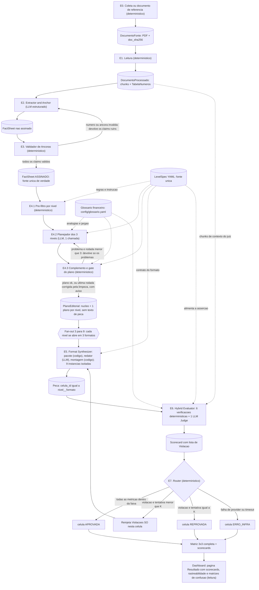
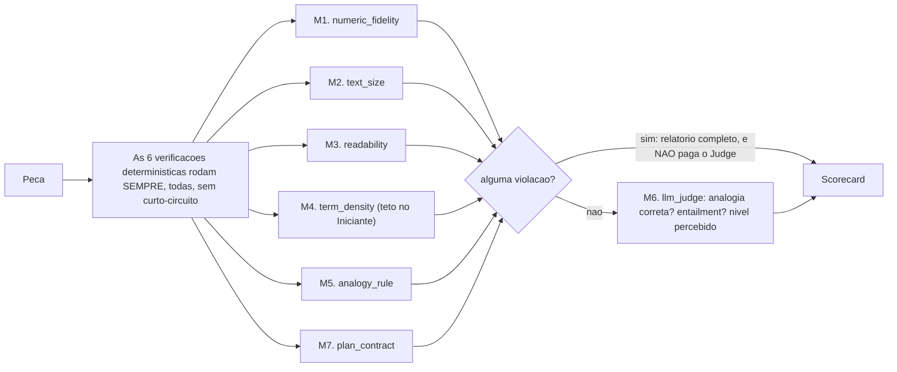
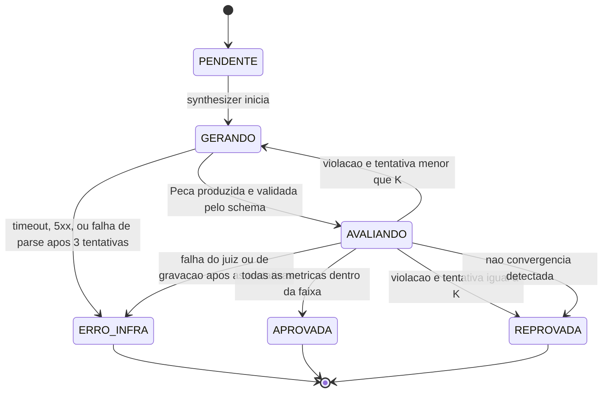

# Arquitetura Suno Content: Grafo Estático em Camadas

## Contexto do projeto

Pipeline de IA que ingere documentos financeiros públicos densos (atas do Copom, fatos relevantes da CVM, releases de resultados da B3) e gera **9 peças por documento**: 3 níveis de audiência (Iniciante, Intermediário, Avançado/Institucional) x 3 formatos (texto analítico, carrossel, roteiro de vídeo <=60s). 

O diferencial não é a geração: é o **Avaliador Híbrido de Calibração e Rigor**, que confere de forma determinística a fidelidade numérica, o tamanho por nível e a regra de analogia, soma o juiz de entailment e reprocessa o que falha.

Fonte de verdade do escopo: o TAPI do projeto.

**Modo de operação:** estúdio editorial. Não há leitor logado nem personalização em runtime. O sistema gera as 9 células para todo documento e um humano lê a matriz no dashboard. Consequência de desenho: o "nível" não é uma inferência, é uma **especificação de saída** que o pipeline precisa cumprir e provar que cumpriu.

## Decisão de arquitetura

Grafo estático em camadas, com fan-out explícito e portão determinístico por célula.

As três propriedades que definem esta escolha:

1. **Um nó por responsabilidade.** Nada de agente generalista decidindo o próprio processo. A topologia é fixa e legível no código.
2. **O LLM redige, o código julga.** Nenhuma saída de modelo altera o valor de uma métrica. O juiz LLM existe, mas só pode reprovar, nunca aprovar algo que o determinístico rejeitou.
3. **A célula é a unidade de trabalho.** Cada uma das 9 combinações nível-formato falha, reprocessa e é auditada de forma isolada.

O que isso compra: número de chamadas de LLM previsível, execução reproduzível, debug por célula, e alucinação numérica estruturalmente impossível de passar.

O que isso custa está em **Trade-offs assumidos**, e o que continua sem solução está em **Lacunas conhecidas**, os dois no fim do documento. Escolher esta arquitetura não elimina os problemas dela.

---

# Objetos de dado (o contrato do pipeline)

Cada etapa é definida pelo que consome e pelo que produz. Estes são os tipos. Eles são o contrato: um nó que não devolve exatamente isto está quebrado, e o harness rejeita antes de seguir.

Os schemas abaixo são contrato, não código de implementação: nomes de campo, tipos e obrigatoriedade são normativos.

## Nível e formato

```python
Nivel   = Literal["iniciante", "intermediario", "avancado"]
Formato = Literal["artigo", "carrossel", "roteiro"]

# celula_id = f"{nivel}__{formato}"  ->  "iniciante__carrossel"
# São sempre 9. A matriz é completa por definição, nunca parcial por escolha.
```

## Número e âncora

```python
class Ancora(BaseModel):
    pagina: int
    offset_inicio: int      # offset de caractere no texto limpo da página
    offset_fim: int

class Numero(BaseModel):
    valor: Decimal          # 12.5
    unidade: Literal["pct", "pp", "BRL", "BRL_mi", "x", "contagem", "data"]
    bruto: str              # "12,5%" exatamente como apareceu no fonte
    ancora: Ancora
```

As unidades cobrem o que os três tipos de documento produzem: `pct` (taxa), `pp` (variação de taxa), `BRL` e `BRL_mi` (valor, normalizado para milhões quando o fonte escreve "bi"), `x` (múltiplo, como alavancagem), `contagem` (número puro: "5 dos 9 membros votaram") e `data` (trimestre, ano, número de reunião). A distinção `pct` vs `pp` não é cosmética: "subiu 0,50 p.p." e "subiu 0,50%" são afirmações diferentes, e confundi-las é erro factual.

Na unidade `data`, cada componente numérico da data é um `Numero`, com o inteiro escrito como valor: `15 e 16 de setembro de 2026` dá 15, 16 e 2026, e `2T26` dá 2 e 26. Pontos-base (`bps`) são gravados como `pp`, com 1 bp igual a 0,01 p.p. As regras completas do parser estão em `docs/fluxos/leitura.md`.

`Numero.valor` é `Decimal`, nunca `float`. Comparação de igualdade com float quebra a verificação de fidelidade numérica silenciosamente.

## Claim

A unidade atômica de fato. Tudo que o sistema afirma tem que ser rastreável a um destes.

```python
class Claim(BaseModel):
    id: str                 # "C07", estável dentro do documento
    texto: str              # a afirmação normalizada, uma frase
    numeros: list[Numero]   # pode ser vazia (claim qualitativo)
    tipo: Literal["decisao", "projecao", "condicionante", "resultado", "risco", "evento_corporativo"]
    tags: list[Literal["impacto_pratico", "metodologico", "contexto_macro", "indicador_chave", "governanca"]]  # pelo menos uma
    ancora: Ancora
    literal_fonte: str      # o trecho exato do documento, verbatim
```

`tipo` e `tags` não são decorativos: a E4 usa `tags` no pré-filtro e como orientação ao planejador (o nível Iniciante descarta o que é só `metodologico`), e o juiz usa `tipo` na pergunta de entailment: projeção apresentada como fato não é implicada pelo claim (uma projeção do Copom não pode virar afirmação do artigo). As tags vêm de um vocabulário fixo, definido em `docs/fluxos/extracao.md`.

`texto` e `numeros` dizem o mesmo: todo número listado aparece no texto, e todo número do texto, exceto datas, está listado. Datas não entram em `numeros`, e a E3 recusa o claim que as liste. Cada `Numero` do claim é uma entrada da `tabela_numeros`, na mesma posição, dentro do `literal_fonte`.

## DocumentoProcessado

```python
class Pagina(BaseModel):
    pagina: int             # 1-indexada
    texto_limpo: str
    ocr: bool = False

class Chunk(BaseModel):
    chunk_id: str           # "K01"
    secao: str | None
    pagina_inicio: int
    offset_inicio: int
    pagina_fim: int
    offset_fim: int
    texto: str

class DocumentoProcessado(BaseModel):
    doc_id: str
    doc_sha256: str
    tipo_documento: Literal["copom_ata", "cvm_fato_relevante", "b3_release"]
    emissor: str
    data_documento: date
    paginas: list[Pagina]
    chunks: list[Chunk]
    tabela_numeros: list[Numero]
```

Saída da E1, detalhada em `docs/fluxos/leitura.md`. `data_documento` é o último dia da reunião no Copom, a data da assinatura na CVM e a data-base do balanço na B3. `emissor` é texto fixo para Copom e B3 e, na CVM, o nome de cada companhia do cabeçalho da primeira página, unidos por `; ` no fato relevante conjunto. O modelo valida a si mesmo: o `bruto` de cada número bate com o texto na âncora e o texto de cada chunk bate com o intervalo das páginas.

## FactSheet

```python
class FactSheet(BaseModel):
    doc_id: str
    tipo_documento: Literal["copom_ata", "cvm_fato_relevante", "b3_release"]
    emissor: str
    data_documento: date
    claims: list[Claim]
    tabela_numeros: list[Numero]        # TODOS os números do fonte, em ordem de posição
    assinado: bool = False              # True só depois da etapa 3
```

`tabela_numeros` é o conjunto de referência da verificação numérica, e contém todo número do documento, não só os que entraram em claims. É a mesma lista do `DocumentoProcessado`: uma entrada por posição, porque o mesmo bruto pode aparecer mais de uma vez no documento. A busca por bruto é `FactSheet.numeros_por_bruto`. Um número que aparece na peça e existe no documento mas não em nenhum claim é um caso diferente de um número inventado, e o relatório de falha precisa distinguir os dois.

## Plano editorial (saída da E4, antes do formato)

```python
MotivoDescarte = Literal["redundante", "secundario", "exige_base_tecnica", "fora_do_foco", "metodologico"]

class Descarte(BaseModel):
    claim_id: str
    motivo: MotivoDescarte
    relacionado: str | None   # obrigatório em "redundante": o claim usado no nível que já diz o mesmo
    origem: Literal["prefiltro", "planejador", "padrao"]

class ClaimPlanejado(BaseModel):
    claim_id: str
    papel: Literal["principal", "apoio", "contexto"]
    prioridade: int           # 1 a n no nível, sem repetir; 1 é o mais importante (corte por formato na E5.1)
    atribuir_fonte: bool      # preenchido pelo código: "o Copom projeta", nunca "a inflação será"

class Analogia(BaseModel):
    termo: str                # "Selic"
    explicacao: str           # "o preço do dinheiro emprestado no país"
    origem: Literal["glossario", "nova"]
    glossario_ref: str | None # "<id do termo>#<n>": a n-ésima analogia do termo no glossário
    revisada: bool            # True só para analogia do glossário com status aprovada

class PlanoNivel(BaseModel):
    nivel: Nivel
    descartes: list[Descarte]
    claims: list[ClaimPlanejado]   # em ordem de leitura
    tese: str                      # uma frase que parafraseia os claims de tese_claim_ids; vazia só quando a limpeza a tirou
    tese_claim_ids: list[str]      # os claims usados no nível que a tese parafraseia
    analogias: list[Analogia]      # uma por termo, a mesma nos 3 formatos do nível; vazia no Avançado

class PlanoEditorial(BaseModel):
    nucleo: list[str]              # 1 a 3 claim_ids: sobre o que é o documento; presentes nos 3 níveis
    niveis: list[PlanoNivel]       # exatamente 3, um por nível
    rodadas: int                   # 1 a 3: a rodada do gate em que o plano ficou pronto (1 é o plano)
    aviso: str | None              # o que a limpeza do código mudou depois da última rodada do gate
```

`rodadas` é o valor final de `rodada_plano` do estado do grafo, igual ao número de linhas do run em `rodadas_plano`. A rodada que passa no gate não grava linha em `validacoes_plano`.

O plano não tem texto de peça, exceto a explicação das analogias `nova`: ele registra decisões (o que entra, em que ordem, com que papel, o que sai e por quê, e quais analogias usar). Quem escreve o texto é a E5, direto dos claims. Assim cada fato passa por uma única redação entre o claim e a peça. A única redação da E4 que chega à peça é a `explicacao` de uma analogia `nova`, que o planejador escreve e o redator usa com o mesmo sentido, só encurtando para caber no orçamento do formato.

`descartes` com motivo existe para auditoria: no nível Iniciante, saber **o que foi cortado e por quê** é a diferença entre adaptação e trivialização. É o campo que o revisor humano olha para julgar se a simplificação perdeu algo que importava. O motivo é um código de lista fixa, e não texto livre, para que parte dos motivos seja conferida por código (ver E4.3). Cada descarte tem uma de três origens: `prefiltro` (motivo `metodologico`, pela regra das tags), `planejador` (só os motivos específicos: `redundante`, `exige_base_tecnica` e `fora_do_foco`) e `padrao` (dado pelo código: `secundario` a todo candidato que o planejador não usou nem descartou com motivo específico e, na limpeza do plano, `secundario` ou `exige_base_tecnica` ao claim que a limpeza tira do nível). Assim o modelo não escreve um motivo para cada candidato não usado, que num release da B3 passaria de duzentos. A saída do planejador tem schema próprio, separado do `PlanoEditorial`, em que o motivo do descarte só aceita os três motivos específicos e não há `origem`: o `llm.py` recusa `metodologico` ou `secundario` na decodificação, e o código preenche a `origem`.

`atribuir_fonte` não é decisão do modelo: o código o preenche com `true` quando o tipo do claim é `projecao`, `condicionante` ou `risco`, os tipos cujo texto a E2 já escreve com atribuição ("Segundo o Copom, ..."). `evento_corporativo` fica de fora, porque é fato consumado.

`prioridade` é decisão do planejador: ordena os claims do nível do mais importante (1) ao menos importante, sem repetir. O plano tem os claims do artigo, o formato mais longo; o carrossel e o roteiro usam menos (E5.1, corte por formato).

No Intermediário, o código atribui, para cada termo com `nivel_minimo` acima de intermediario encontrado no texto dos claims usados, a `definicao_simples` do glossário como `explicacao` (sem `glossario_ref` e com `revisada=False`), sem chamada ao modelo. As analogias do glossário também são atribuídas pelo código, depois da seleção: para cada termo do glossário com `nivel_minimo` acima de iniciante encontrado no texto dos claims usados no Iniciante, o código usa a primeira analogia `aprovada` do termo ou, sem nenhuma aprovada, a primeira `rascunho`, e preenche `glossario_ref`, `explicacao` e `revisada`. O modelo só escreve analogias `nova`, para termos sem analogia no glossário. Na matriz do dashboard, toda analogia com `revisada=False` aparece marcada como não revisada: as `nova` e as do glossário que ainda estão em `rascunho`.

## Peça final (saída do synthesizer)

Os três payloads são **estruturados, não texto corrido**. Isso é decisão de desenho, não estilo: o contrato de formato só é verificável de verdade se a estrutura for dado. Um roteiro em markdown com `"0:00-0:05"` no meio da prosa transforma a checagem de 60s em regex e esperança; um roteiro como lista de cenas transforma a mesma checagem em aritmética.

```python
class Secao(BaseModel):
    texto: str
    claim_ids: list[str]    # não vazio: toda seção tem lastro

class ArtigoPayload(BaseModel):
    titulo: str             # aceita número, só por marcador
    linha_fina: str         # sem número com marcador
    secoes: list[Secao]

class Slide(BaseModel):
    papel: Literal["gancho", "corpo", "conclusao"]
    texto: str
    claim_ids: list[str]    # vazio só no gancho e na conclusão

class CarrosselPayload(BaseModel):
    slides: list[Slide]     # um gancho no início, slides de corpo e uma conclusao no fim

class Cena(BaseModel):
    inicio_s: int
    fim_s: int
    fala: str
    gancho_visual: str      # sem número com marcador
    claim_ids: list[str]    # vazio só na abertura (primeira cena) e no fechamento (última)

class RoteiroPayload(BaseModel):
    cenas: list[Cena]       # contíguas a partir de 0 s

class NumeroUsado(BaseModel):
    campo: Literal["texto", "titulo"]
    unidade_indice: int | None  # posição da seção, slide ou cena; None no título
    inicio: int             # offset do número no campo, depois da troca do marcador
    fim: int
    claim_id: str           # o marcador {{C27.1}} é o número 1 do claim C27
    ordem: int              # 1-indexado, a posição do número na lista do claim

class Peca(BaseModel):
    celula_id: str
    nivel: Nivel
    formato: Formato
    payload: ArtigoPayload | CarrosselPayload | RoteiroPayload
    claim_ids: list[str]    # união dos claim_ids internos
    numeros_usados: list[NumeroUsado]
    tentativa: int          # 1-indexado
```

O redator não devolve a `Peca`. Cada formato tem um schema de saída próprio, `SaidaArtigo`, `SaidaCarrossel` e `SaidaRoteiro`, com a mesma estrutura do payload e os marcadores no texto. Os validadores desses schemas impõem as regras que valem para qualquer célula, e uma resposta que as quebra volta ao modelo pelo `llm.py` sem consumir o `K`:

- o carrossel tem um `gancho` no início, slides de `corpo` e uma `conclusao` no fim, pelo menos 3 slides;
- as cenas do roteiro são contíguas a partir de 0 s, cada uma com duração positiva, pelo menos 3 cenas;
- `claim_ids` vazio só no gancho e na conclusão do carrossel e na abertura e no fechamento do roteiro; seção, slide de corpo e cena de claim usam pelo menos um claim;
- a `linha_fina` e o `gancho_visual` não aceitam marcador.

As regras que dependem do LevelSpec ou do plano (quantidade de slides, soma das cenas até `duracao_s`, `claim_ids` dentro do plano do nível, cobertura do formato) ficam na montagem como violações do M7 (`plan_contract`) e consomem o `K`.

Número com marcador vale no texto das unidades e no `titulo` do artigo; é proibido na `linha_fina` e no `gancho_visual`. Por isso `NumeroUsado` tem `campo` (`texto` ou `titulo`), e o número do título não tem `unidade_indice`.

A checagem de palavras por segundo no roteiro é um exemplo do que só existe porque o payload é estruturado: um roteiro de 60s com 400 palavras é impossível de falar, passa em qualquer leitura de estilo, e só a aritmética pega.

O texto do payload é o texto final, com os números já no lugar dos marcadores. `numeros_usados` diz de onde veio cada número: do marcador ao claim e, pelo claim, à âncora no PDF. É o que permite ao dashboard levar cada número da peça à página do documento.

As palavras e os caracteres de uma peça são contados por `sunontent/texto.py`, a mesma função do orçamento da E5.1, do prompt do redator e da M2, sobre o texto depois da troca dos marcadores. Palavra é a sequência sem espaço que tem pelo menos uma letra ou um dígito (`R$ 1,2 bi` tem 3 palavras e `IPCA-15` tem 1); caractere é o do texto sem os espaços das pontas.

## Scorecard e violação

```python
Metrica = Literal["numeric_fidelity", "text_size", "readability", "term_density", "analogy_rule", "llm_judge", "plan_contract"]

class Violacao(BaseModel):
    metrica: Metrica
    trecho: str                 # o texto exato que violou
    esperado: str               # "numero presente na tabela do fonte"
    obtido: str                 # "4,75%"
    instrucao_corretiva: str    # o que fazer, em linguagem imperativa
    unidade_indice: int | None  # onde está: a seção, o slide ou a cena
    campo: Literal["titulo", "linha_fina", "texto", "gancho_visual"] | None
    inicio: int | None          # intervalo do trecho no campo
    fim: int | None

class MetricaResultado(BaseModel):
    nome: Metrica
    valor: float | bool         # número de violações; true ou false na llm_judge
    faixa_esperada: str         # "0"
    passou: bool
    violacoes: list[Violacao]
    detalhes: Detalhes          # um modelo por métrica, escolhido pelo campo `metrica`

class Scorecard(BaseModel):
    celula_id: str
    tentativa: int
    metricas: list[MetricaResultado]
    veredito: Literal["APROVADA", "REPROVADA", "ERRO_INFRA"]   # da tentativa
    custo_tokens: int
    duracao_ms: int
```

O `veredito` é da tentativa: `APROVADA` se todas as métricas passaram, `REPROVADA` se alguma falhou, `ERRO_INFRA` se o juiz ou a gravação falharam com a peça existente. O estado final da célula não fica no scorecard: fica só em `celulas`, gravado pela E7.

`numeric_fidelity`, `analogy_rule` e M7 (`plan_contract`) valem o número de violações, com faixa `"0"`. `text_size` vale o número de unidades fora do limite, e a faixa traz o limite renderizado do LevelSpec. `llm_judge` vale `true` quando o juiz não reprova nada e `false` quando reprova. `Violacao.campo` diz onde está o trecho: `texto` é o texto da seção ou do slide e a fala da cena.

Cada métrica tem o seu modelo de `detalhes`, gravado em `metricas.detalhes`:

| Métrica | Campos de `detalhes` |
| ------- | -------------------- |
| `numeric_fidelity` | `numeros_varridos`, `com_marcador`, `datas_conferidas` e `desfechos` (a contagem de cada desfecho da M1, inclusive o número em formato que o parser não lê) |
| `text_size` | `grandeza` (`palavras` ou `caracteres`), `limite` (o limite renderizado) e `unidades` (a medida e o limite de cada unidade; no roteiro, a última é o total) |
| `readability` | `palavras`, `silabas`, `frases`, `ifl`, `ifl_minimo` e `frase_max_palavras` (os do nível, quando existem), `analogia_na_peca` e `nivel_estatistico` (o sinal de nível da peça: no artigo, o nível da faixa de IFL; no carrossel e no roteiro, IFL no piso do Iniciante e analogia na peça) |
| `term_density` | `palavras`, `ocorrencias`, `densidade` (por 100 palavras), `ocorrencias_avancado`, `densidade_avancado`, `termos` (cada termo acima de iniciante encontrado, com o nível e a contagem), `densidade_maxima` e `ocorrencias_maximas` (o teto do formato no Iniciante e o limite em ocorrências; `None` nos outros níveis) |
| `analogy_rule` | `aplicavel` (a regra vale no Iniciante e no Intermediário) e `termos` (cada termo acima do nível encontrado, com a unidade da primeira ocorrência, se há `Analogia` no plano e se há marcador na unidade) |
| `plan_contract` | `checagens` (quantidade de slides, soma das cenas, `claim_ids` no plano e cobertura do formato, cada uma com o esperado, o obtido e se passou) |
| `llm_judge` | `analogias` (termo, justificativa e `correta`), `unidades` (índice, justificativa, `implicada` e trecho problemático), `justificativa_nivel` e `nivel_percebido` |

## Run manifest

O objeto que torna uma execução reproduzível. Sem ele, "o mesmo documento com o mesmo código" não garante o mesmo resultado, porque o provider pode ter atualizado o modelo por baixo.

```python
class RunManifest(BaseModel):
    run_id: str                      # <fonte>_<AAAAMMDDTHHMMSSZ>_<6 hex>
    timestamp: datetime
    modo: Literal["normal", "dev"]   # entrada do run: E0 (download) ou documento de referência (--dev)
    fonte: Literal["copom", "cvm", "b3"]
    doc_id: str | None
    doc_sha256: str | None           # hash do arquivo fonte, não só o nome; None só em run abortado antes do documento
    url_origem: str | None           # de onde o documento foi baixado
    coletado_em: datetime | None     # quando foi baixado; no --dev, a data do download congelado
    coleta_id: int | None            # coleta da E0; None no --dev e no run abortado antes da coleta
    modelos: dict[str, str]          # {"extractor": "<snapshot>", "judge": "<snapshot>", ...}
    prompts: dict[str, int]          # {"adapter": 3, "synthesizer": 2, ...} versão do cabeçalho de cada template
    level_specs: dict[Nivel, int]    # {"iniciante": 1, ...} versão do YAML de cada nível
    glossario_versao: int            # chave versao de config/glossario.yaml
    arquivos_sha256: dict[str, str]  # {"prompts/adapter.j2": "<sha256>", "config/glossario.yaml": "<sha256>", ...}
    K: int                           # orçamento de retry vigente nesta execução, lido de sunontent/graph.py
    max_concorrencia: int            # células em paralelo no fan-out, lido de sunontent/graph.py (MAX_CONCORRENCIA)
    custo_total_tokens: int
    custo_total_brl: Decimal
```

O run é registrado no início, antes da E0 ou da leitura da referência. `run_id` identifica uma execução no formato `<fonte>_<AAAAMMDDTHHMMSSZ>_<6 hex>`, ex: `copom_20261004T142205Z_9f2c1a`: fonte, instante de início em UTC (o mesmo de `timestamp`) e 6 caracteres hexadecimais aleatórios. O `__main__.py` gera o `run_id` antes de o grafo começar, nos dois modos. Ele nomeia a pasta do run em `data/runs/`. Os campos de documento ficam vazios até o `DocumentoFonte` ser entregue. Se o run inteiro falha (E0, referência, leitura na E1 ou uma etapa do grafo), ele termina com status `abortado`, a classe, a mensagem e a etapa do erro.

`doc_sha256` existe porque "ata de setembro" não identifica um arquivo: o Banco Central emite de novo o PDF corrigido. Dois runs sobre "o mesmo documento" com hashes diferentes não são comparáveis, e sem o hash ninguém descobre isso.

`K` entra no manifesto porque mudar o orçamento de retry muda o resultado. Um scorecard só é comparável com outro se o `K` era o mesmo.

`max_concorrencia` entra no manifesto porque define quantas chamadas de LLM chegam juntas ao provider; com limite de taxa baixo, o valor muda quais células terminam em `ERRO_INFRA`.

`modo` entra no manifesto porque define a entrada: no dev é o documento de referência, fixo e versionado; no normal, o documento mais recente. Consultas que medem o avaliador filtram por ele.

As versões vêm dos próprios arquivos: a chave `versao` no topo de cada YAML de `config/levels/` e de `config/glossario.yaml`, e a linha `{# versao: N #}` no início de cada template de `prompts/`. O número é inteiro, escolhido à mão, e sobe a cada mudança de conteúdo. `arquivos_sha256` guarda o SHA-256 de cada um desses arquivos e de `config/models.yaml`, calculado no início do run sobre o conteúdo com fim de linha normalizado para `\n`, para que o mesmo arquivo tenha o mesmo hash em qualquer sistema operacional. Dois runs com a mesma `versao` e hashes diferentes revelam um arquivo editado sem subir a versão. `K` é uma constante de `sunontent/graph.py`, e o valor lido no início do run é o que entra no manifest.

A linha de `runs` no Supabase guarda o RunManifest e o estado do run, que não faz parte do manifest: `status` (`em_andamento`, `concluido` ou `abortado`) e, no run abortado, `erro_classe`, `erro_mensagem` e `etapa_erro` (o nó do grafo em execução; nula quando o run abortou fora do grafo). O manifest não muda depois de fechado; `status`, custos e erro são atualizados durante o run.

`Violacao.instrucao_corretiva` é o campo mais importante do sistema inteiro. O refinement loop não reinjeta números: reinjeta instruções. "text_size 3, esperado 0" não diz ao modelo o que fazer. "Reduza as 3 seções marcadas abaixo, cada uma tem mais de 160 palavras" diz. Ver a seção do Refinement Loop.

---

# Diagrama do fluxo



---

# As etapas, uma por uma

Cada etapa abaixo segue o mesmo formato: o que representa, o que recebe, o que faz, o que decide, o que gera, se é LLM ou código, e como falha. Toda gravação citada em **Gera** é feita pelo nó da etapa, por `sunontent/persistencia.py`, no Supabase e na cópia local do run em `data/runs/<run_id>/`.

## E0. Coleta

Detalhada em `docs/fluxos/ingestao.md`. No modo normal, baixa o documento mais recente da fonte, grava o PDF no bucket `documentos` e em `data/sources/`, registra o documento e a coleta no Supabase e entrega à E1 um `DocumentoFonte`. No modo `--dev`, o nó de referência entrega o `DocumentoFonte` do documento congelado em `tests/fixtures/referencia/`, registrado no Supabase se ainda não estiver lá.

## E1. Leitura

**Representa:** a fronteira entre o mundo externo (um PDF de origem não controlada) e o pipeline. Tudo depois daqui trabalha sobre texto normalizado e posicionado.

**Recebe:** `DocumentoFonte` (`docs/fluxos/ingestao.md`), com o caminho local do PDF. Antes de extrair, confere o SHA-256 dos bytes lidos contra `doc_sha256`.

**O que faz:**

1. Extrai texto por página preservando offset de caractere. O offset é o que permite a âncora existir; se a extração perder posição, a rastreabilidade do Entregável 4 morre aqui.
2. OCR só como fallback, quando a página não tem camada de texto (comum em fatos relevantes escaneados). O OCR ainda não está implementado: hoje a página sem camada de texto aborta o run com erro terminal.
3. Normaliza o texto: remove cabeçalho/rodapé repetido, junta palavras hifenizadas quebradas por linha, colapsa espaço.
4. Faz chunking por seção lógica, não por tamanho fixo. Ata do Copom tem estrutura numerada; release da B3 tem seções nomeadas. Chunk que corta uma tabela no meio gera claim sem número.
5. **Varre todos os números e monta a `tabela_numeros`.** Parser de formato brasileiro: `12,5%` vira `Decimal("12.5") + unidade "pct"`, `R$ 1,2 bi` vira `Decimal("1200") + "BRL_mi"`, `0,50 p.p.` vira `Decimal("0.50") + "pp"`. Cada um com âncora.
6. Extrai metadados: tipo de documento, emissor, data.

**Decide:** nada. É determinístico ponta a ponta e é a única etapa que pode ser testada com igualdade exata contra um fixture.

**Gera:** `DocumentoProcessado` com chunks posicionados, `tabela_numeros` e metadados. Grava os metadados (`doc_id`, `doc_sha256`, tipo, emissor e data) em `documentos_processados`, o texto limpo por página em `documento_paginas`, os chunks em `chunks` e a `tabela_numeros` em `numeros`.

**Natureza:** determinístico. Zero LLM, zero token. Detalhada em `docs/fluxos/leitura.md`.

**Como falha:** arquivo ausente ou SHA-256 dos bytes diferente do `doc_sha256` do `DocumentoFonte`: aborta o run com erro terminal, indicando o arquivo, o hash esperado e o encontrado, e pedindo para apagar o arquivo local; a próxima coleta grava o PDF de novo. PDF sem camada de texto e OCR ruim: aborta o run com erro terminal, não gera claims errados. Número em formato não previsto (`1.234,56` vs `1,234.56`) é o bug mais provável de toda a etapa, e ele se manifesta bem longe daqui: como falso positivo de fidelidade numérica na etapa 6. Teste esta etapa com paranoia.

## E2. Extractor & Anchor

**Representa:** a única etapa que **lê** o documento com julgamento. Decide o que, em 12 páginas de ata, merece existir como fato.

**Recebe:** `DocumentoProcessado`; nas rodadas de correção, também os claims devolvidos pela E3, com o motivo.

**O que faz:**

1. Numa única chamada, com o documento inteiro, o modelo emite claims atômicos: uma afirmação por claim, sem conjunção de dois fatos.
2. Para cada claim, o modelo cita o `literal_fonte` verbatim e o bloco (`chunk_id`) de onde ele veio; o código localiza o trecho no texto limpo e registra a âncora.
3. O modelo lista o bruto de cada número do claim; o código associa a entrada da `tabela_numeros` com esse bruto dentro do `literal_fonte`.
4. O modelo classifica `tipo` e atribui `tags`.

O modelo nunca escreve página, offset nem valor: o que ele cita e não existe no documento não resolve, e o claim volta para correção. Detalhada em `docs/fluxos/extracao.md`.

**Decide:** a granularidade e a seleção. É a decisão de mais alto risco do pipeline: um fato importante que não se torna claim **não existe** para o resto do sistema, e nenhuma etapa posterior detecta a ausência, porque todas validam contra o FactSheet e não contra o documento.

**Gera:** `FactSheet` com `assinado=False`. O FactSheet não assinado fica só no estado do grafo; a E2 grava só os spans em `llm_spans` e o custo em `runs` (cópia em `data/runs/<run_id>/`). O FactSheet é gravado uma vez, pela E3.

**Natureza:** LLM com saída estruturada obrigatória (`gemini-3.8-flash`), mais ancoragem determinística.

**Como falha:** omissão silenciosa (o risco real), granularidade grossa demais (claim com dois fatos torna a verificação de entailment ambígua), e âncora inventada. Os dois últimos a etapa 3 pega: a âncora inventada não resolve, e o claim com números de outro fato reprova na conferência entre texto e números. O primeiro exige teste com documento anotado à mão: um fixture de ata com a lista de fatos que **devem** aparecer, e assert de cobertura.

## E3. Validador de Âncoras

**Representa:** o ponto onde o FactSheet deixa de ser sugestão de um modelo e passa a ser referência confiável. Depois daqui, o resto do pipeline confia no FactSheet sem reverificar.

**Recebe:** `FactSheet` não assinado + `tabela_numeros`, e os claims que a E2 não conseguiu ancorar, que reprovam com o motivo da E2.

**O que faz:**

1. Para cada claim: confere que `ancora.pagina` existe e que o texto no intervalo de offset contém de fato o `literal_fonte`. Âncora que não resolve, reprova o claim.
2. Para cada `Numero` do claim: confere presença na `tabela_numeros`, com valor **e** unidade. Confusão de `pp` com `pct` é o erro clássico aqui e é semanticamente grave: "subiu 0,50 p.p." e "subiu 0,50%" são coisas diferentes.
3. Confere que `literal_fonte` é substring real do texto da página, não paráfrase.
4. Confere que o texto do claim e a lista de números dizem o mesmo, lendo o texto com o parser da E1.
5. Se algum claim reprovar, devolve **só os claims ruins** para a etapa 2 com o motivo, e não o documento inteiro. O loop tem no máximo 3 rodadas (a extração e 2 correções); se ainda houver claim reprovado, ele é descartado pelo código, com o motivo registrado na linha da última rodada em `validacoes_ancora`, e o FactSheet é assinado só com os claims válidos. Nenhuma pessoa decide se um claim entra ou sai. Sem nenhum claim válido, o run aborta com erro terminal. Detalhado em `docs/fluxos/extracao.md`, Descarte.

**Decide:** claim por claim, aprova ou devolve. Sem nota, sem gradiente: booleano.

**Gera:** `FactSheet` com `assinado=True`, ou um pedido de correção parcial. Grava o resultado de cada rodada em `validacoes_ancora` e, quando todos os claims passam (ou, depois da última rodada, no nó `descarte`, com os válidos), o FactSheet assinado em `factsheets`, `claims` e `claim_numeros`, numa transação. O FactSheet é gravado uma vez e não muda depois de assinado: quem o lê (`carregar_factsheet`) vê sempre o FactSheet inteiro ou nenhum.

**Natureza:** determinístico. É código puro comparando strings e `Decimal`.

**Como falha:** se a etapa 1 normalizou o texto de um jeito e a etapa 2 citou o texto de outro, tudo reprova e o loop entre 2 e 3 não converge. Mitigação: o `literal_fonte` é comparado contra o **texto limpo** que a etapa 2 recebeu, nunca contra o PDF original. As duas etapas tem que ver exatamente o mesmo texto.

## E4. Plano editorial (pré-filtro, planejador e gate)

Valores do LevelSpec, modelo, leitor do glossário, gravação e fim do grafo em `docs/fluxos/plano-editorial.md`.

**Representa:** a adaptação conceitual, separada da adaptação de forma. Aqui se decide **o que dizer, em que ordem e com que profundidade** para cada nível; ainda não se decide se é artigo, carrossel ou vídeo, e nenhum texto da peça é escrito.

Essa separação é o que evita a trivialização por encurtamento: se adaptar o nível e formatar fossem o mesmo nó, "versão iniciante do carrossel" tenderia a virar "o mesmo carrossel com menos palavras". Aqui o Iniciante e o Avançado partem do mesmo FactSheet e **fazem escolhas de conteúdo diferentes**, não só de vocabulário.

**Recebe:** `FactSheet` assinado + o `LevelSpec` dos 3 níveis + o glossário.

A etapa tem três passos: o código faz o que uma regra resolve, o LLM faz o que exige julgamento, e o código confere o resultado. Nenhuma regra depende de um documento específico: todas leem só o que qualquer FactSheet tem (`tipo` e `tags` de vocabulário fixo, ids e texto dos claims), o LevelSpec e o glossário.

### E4.1 Pré-filtro por nível (determinístico)

Para cada nível, cada claim vira **candidato** ou **descartado por regra**:

- descartado por regra quando **todas** as tags do claim estão em `tags_descartaveis` do nível, com o motivo `metodologico` e `origem="prefiltro"`. Um claim com uma tag descartável e outra não descartável continua candidato;
- candidato nos demais casos.

`tags_descartaveis` só aceita a tag `metodologico`, a única que corresponde a um motivo de descarte; o `levelspec.py` recusa qualquer outra tag nesse campo.

O pré-filtro só remove o óbvio. A prioridade entre os candidatos não é decidida por tag, porque as tags atribuídas pela E2 diferenciam pouco os claims (num release da B3, a maioria sai como `indicador_chave`; numa ata do Copom, a maioria sai como `contexto_macro`).

### E4.2 Planejador dos 3 níveis (LLM, 1 chamada)

**Recebe:** o que vem primeiro no tipo de documento (`docs/fluxos/plano-editorial.md`, Prompt do planejador), os claims (id, texto, tipo e tags, e os termos do glossário acima de iniciante que aparecem no texto, cada um com o seu `nivel_minimo` e se tem analogia no glossário), os candidatos e os descartes do pré-filtro por nível, com a marca dos claims candidatos nos 3 níveis, o LevelSpec dos 3 níveis renderizado em instruções concretas (`foco`, `tags_priorizadas`, `max_claims` do artigo) e a lista dos termos do glossário com `nivel_minimo` acima de iniciante encontrados no texto dos candidatos do Iniciante que não têm nenhuma analogia no glossário. Sem nenhum claim candidato nos 3 níveis, o run aborta com erro terminal antes de chamar o modelo: o núcleo não tem de onde sair.

**Devolve,** com os campos nesta ordem no schema, porque em saída estruturada o modelo escreve na ordem do schema e primeiro justifica para depois decidir:

1. `nucleo`: de 1 a 3 claims que respondem "sobre o que é este documento" (numa ata do Copom, a decisão de juros; num fato relevante, o evento principal). O núcleo entra nos 3 níveis, por isso só pode ser escolhido entre os claims candidatos nos 3 níveis: um claim descartado pelo pré-filtro em algum nível não pode ser núcleo.
2. Para cada nível: os descartes com motivo específico (`redundante`, com o claim usado que já diz o mesmo e tem todos os números e datas do descartado; `exige_base_tecnica`, só com termo acima do nível e nunca no Avançado; ou `fora_do_foco`); os claims que entram, em ordem de leitura, com o papel e a prioridade; a tese, uma paráfrase dos claims que a sustentam, sem causa, tendência ou recomendação que eles não digam, sem números além de datas e, no Iniciante, sem termo técnico; e, no Iniciante, as analogias `nova` para os termos da lista que estiverem nos claims usados, começando com "É como..." e sem números.

O planejador fica só com o que exige julgamento editorial: núcleo, seleção, ordem, papel, prioridade, tese e analogias para termos do glossário sem analogia. O papel do núcleo e a presença do núcleo na tese ficam livres nos 3 níveis: o Iniciante pode abrir com outro fato de impacto prático. O que é regra fixa (`atribuir_fonte`, o descarte `secundario` dos candidatos restantes e as analogias que o glossário já tem) é feito pelo código no passo seguinte.

O prompt também diz como o Intermediário e o Avançado se diferenciam na escolha: o Intermediário fica com os fatos que mudam algo para quem já investe e deixa de fora o detalhe técnico e metodológico que não muda essa leitura; o Avançado inclui as premissas e a metodologia, o balanço de riscos, a orientação futura em detalhe e a governança.

Uma chamada para os 3 níveis, e não uma por nível: o modelo enxerga o contraste e diferencia os níveis de propósito, que é o que a matriz de confusão de níveis do Entregável 6 mede. O isolamento por nível não traria ganho aqui, porque a E4 nunca é refeita no retry das células. Se os runs mostrarem seleção ruim (gate reprovando com frequência, ou a leitura humana da matriz discordando das seleções), a alternativa é 1 chamada para o núcleo e 3 em paralelo, uma por nível, com o núcleo fixo.

### E4.3 Complemento e gate do plano (determinístico)

**Complemento.** Antes de conferir, o código completa o plano:

1. `atribuir_fonte=true` nos claims usados de tipo `projecao`, `condicionante` ou `risco`, e `false` nos demais;
2. todo candidato que o planejador não usou nem descartou vira descarte `secundario`, com `origem="padrao"`;
3. no Iniciante, cada termo do glossário com `nivel_minimo` acima de iniciante encontrado no texto dos claims usados recebe a primeira analogia `aprovada` do termo ou, sem nenhuma aprovada, a primeira `rascunho`;
4. no Intermediário, cada termo com `nivel_minimo` acima de intermediario encontrado no texto dos claims usados recebe a `definicao_simples` do glossário como explicação.

A tese e os seus ids seguem como o planejador mandou: quem confere é o gate.

**Gate.** Roda em todo run, nos dois modos, sobre o plano completo. Cada regra é uma comparação:

| Regra | Comparação |
|---|---|
| `id_inexistente` | todo `claim_id` do plano (núcleo, claims, descartes, `relacionado`, `tese_claim_ids`) existe no FactSheet |
| `contraditorio` | nenhum claim aparece duas vezes nos claims de um nível, nem está ao mesmo tempo nos claims e nos descartes, nem em dois descartes do mesmo nível (por exemplo, descartado pelo pré-filtro e de novo pelo planejador) |
| `nucleo_ausente` | todo claim do núcleo é candidato nos 3 níveis e está nos claims dos 3 níveis |
| `acima_do_limite` | claims usados no nível <= `max_claims` do artigo no LevelSpec |
| `prioridade_invalida` | as prioridades dos claims do nível são 1 a n, sem repetir |
| `jargao_sem_analogia` | no Iniciante, todo termo do glossário com `nivel_minimo` acima de iniciante encontrado no texto de um claim usado tem analogia no plano, do glossário ou `nova` |
| `analogia_invalida` | a explicação de cada analogia `nova` não tem dígito, não tem `{{` e não só repete o termo (sem as formas do termo, a pontuação e as palavras de ligação, sobra alguma palavra) |
| `motivo_invalido` | `redundante` tem `relacionado`, o relacionado está nos claims do nível e tem todos os números (por valor e unidade) e todas as datas (dia, mês e ano; ano ausente vale para qualquer ano) do descartado; `exige_base_tecnica` só em claim com termo do glossário de `nivel_minimo` acima do nível, o que nunca acontece no Avançado |
| `tese_invalida` | a tese não está vazia, cita pelo menos um claim, todo id de `tese_claim_ids` que existe está nos claims do nível, não tem número que não seja data (lido com `numeros.varrer`, fora as formas dos termos do glossário, como o 15 de IPCA-15) e, no Iniciante, não tem termo do glossário com `nivel_minimo` acima de iniciante |

`fora_do_foco` e `secundario` não têm conferência por código: quem os confere é o revisor humano na matriz do dashboard, que vê a lista de descartes. O gate também não julga se o núcleo escolhido é o mais importante do documento, nem o papel do núcleo, nem se a tese diz o mesmo que os claims que cita.

Com algum problema, o código devolve ao planejador só a lista de problemas, como o loop E2/E3, com no máximo 3 rodadas (o plano e 2 correções). Cada rodada grava em `rodadas_plano` a saída do planejador e em `validacoes_plano` os problemas.

**Limpeza.** Se ainda houver problema depois da última rodada, o código corrige o plano para que ele passe no gate, nesta ordem:

1. ids inexistentes saem do núcleo, dos claims, dos descartes e da tese; o descarte cujo `relacionado` não existe vira `secundario` com origem `padrao`;
2. o claim repetido nos claims fica uma vez; o claim que o pré-filtro tirou do nível sai dos claims e dos descartes do planejador; o claim usado e descartado pelo planejador fica usado; o claim em dois descartes do planejador fica no primeiro;
3. sai do núcleo o claim que não é candidato nos 3 níveis; o claim do núcleo que falta num nível entra no fim da ordem de leitura, como `apoio`, com a prioridade seguinte;
4. a analogia `nova` inválida sai do plano;
5. o claim do Iniciante com termo sem analogia sai do nível como `exige_base_tecnica`, com origem `padrao`;
6. no nível acima do limite, ficam o núcleo e os claims de maior prioridade até o `max_claims`, e os outros viram `secundario` com origem `padrao`;
7. o descarte do planejador com motivo inválido vira `secundario` com origem `padrao`;
8. saem da tese os ids repetidos e os que não estão nos claims do nível; a tese sem id, vazia, com número ou, no Iniciante, com termo técnico fica vazia e sem ids, e a E5 não recebe tese desse nível;
9. as prioridades são renumeradas de 1 a n, na ordem que tinham, e as analogias do Iniciante e as explicações do Intermediário ficam só para os termos dos claims que restaram.

O `aviso` do plano lista o que a limpeza mudou, com a regra e o nível de cada mudança, e é mostrado na matriz do dashboard. A E5 e a E7 não precisam de regra para plano com defeito: o plano que chega à E5 passa sempre no gate (a única tese vazia aceita é a que a limpeza produziu).

O run aborta com erro terminal, depois de gravar as rodadas, só em dois casos: o núcleo fica vazio, ou um claim do núcleo tem, no Iniciante, termo sem analogia. Por segurança, o gate confere o plano limpo, e problema que ainda restasse também seria erro terminal. Sem núcleo, a matriz de 9 células não tem o que escrever; o núcleo entra nos 3 níveis e não pode sair do Iniciante.

**Decide:** núcleo, seleção de conteúdo por nível, ordem, papel, prioridade, tese e analogias.

**Gera:** `PlanoEditorial`, agnóstico de formato. Grava cada rodada do gate em `rodadas_plano` e `validacoes_plano`, o plano em `planos_editoriais` e `planos_nivel`, e cria as 9 células em `celulas`, no estado `PENDENTE`.

**Natureza:** determinístico, LLM e determinístico.

**Como falha:** trivialização (descarta claim essencial e mantém só o trivial; o gate pega o núcleo ausente, e o revisor vê os descartes na matriz do dashboard), núcleo mal escolhido (só o humano pega), analogia enganosa (a analogia está lá, é estruturada, e explica errado: só o juiz LLM da etapa 6 pega isso; as analogias aprovadas do glossário reduzem o risco), e **duplicação de prompt**: o planejador tem um template único, `prompts/adapter.j2`, parametrizado pelo LevelSpec.

## E5. Format Synthesizer (9 instâncias isoladas)

Divisão do orçamento, prompt do redator, montagem, nó e gravação em `docs/fluxos/sintese.md`.

**Representa:** a mesma tese e os mesmos claims reencenados em três gramáticas de mídia diferentes. Um artigo argumenta, um carrossel escaneia, um roteiro é falado em voz alta.

**Recebe:** 1 dos 3 `PlanoNivel` + os claims do plano, lidos do FactSheet assinado do run por `carregar_factsheet` (com os números de cada claim na ordem de `claim_numeros`) + o contrato do formato no LevelSpec do nível. Aqui acontece o fan-out de 3 para 9: cada `PlanoNivel` é consumido por 3 synthesizers diferentes.

A etapa tem três passos, e só o do meio chama o modelo.

### E5.1 Pacote da célula (determinístico)

1. **Corte por formato.** O plano do nível tem os claims do artigo. O carrossel e o roteiro usam no máximo o `max_claims` do seu formato no LevelSpec: entram o núcleo e, nas vagas que sobram, os claims de maior prioridade, reordenados pela ordem de leitura do plano. As analogias acompanham os claims do formato.
2. **Claims com marcadores.** Para cada claim do formato, o código varre o texto do claim com `numeros.varrer`, ignora os achados com unidade `data`, e troca o trecho de cada achado pelo seu marcador, ``: em "O Copom decidiu reduzir a taxa básica de juros para 13,75% a.a.", o `13,75%` vira `{{C27.1}}`. Cada achado, em ordem de aparição no texto, casa com a primeira entrada ainda livre da lista de números do claim (`claim_numeros`, na ordem de `ordem`) com o mesmo valor e a mesma unidade; achado sem entrada ou entrada sem achado é erro terminal de dado. As datas ficam no texto, sem marcador. O redator recebe o texto com marcadores e a tabela de cada marcador com o trecho do texto do claim (`5,2%`, e não o `5,2` da célula de tabela do documento).
3. **Contrato do formato com a conta feita.** O código lê o contrato do formato no LevelSpec e calcula o espaço disponível. No carrossel: de 5 a 7 slides, com um gancho, os slides de corpo e uma conclusão, e o limite de caracteres de cada papel (gancho, corpo e conclusão). No roteiro: o total de palavras (`duracao_s` × `palavras_por_segundo`, 150 palavras em 60 s), uma cena de abertura com o gancho (`abertura_s`), uma cena por claim e uma de fechamento (`fechamento_s`), com as palavras que sobram divididas entre as cenas de claim pelo `peso_papel` de cada claim. No artigo: a faixa de palavras do nível dividida entre os claims pelo `peso_papel`. As palavras e os caracteres são contados por `sunontent/texto.py`, a mesma função da M2. O modelo recebe o orçamento pronto, sem precisar fazer a conta.
4. **O plano do nível:** a tese, quando o plano tem tese no nível, ordem, papel e `atribuir_fonte` de cada claim, e as analogias, com a explicação, que o redator mantém no sentido e só encurta para caber no orçamento do formato. As analogias vão presas aos claims: para cada termo, os claims do formato em que ele aparece e a instrução "explique na primeira vez que usar o termo", o que funciona com qualquer ordem escolhida pelo redator. O pacote traz também a `data_documento`: o redator pode dar o ano do documento a uma data que o claim escreve sem ano.
5. **Termos a explicar.** No nível com o bloco `vocabulario` do LevelSpec (o Intermediário), os termos do glossário com `nivel_minimo` acima de `explicar_acima_de` que aparecem no texto dos claims do formato, cada um com a `definicao_simples` e os claims em que aparece. O termo que já tem explicação no plano do nível sai da lista, porque o redator o recebe com a explicação do plano. O redator explica cada um em poucas palavras na primeira vez que o usa, ou o troca pela explicação. No Avançado a lista é vazia, e o Iniciante explica pelas analogias.

### E5.2 Redator (LLM)

Um único template, `prompts/synthesizer.j2`, com três partes: as regras comuns (não criar fatos, escrever todo número que não seja data só por marcador, seguir a ordem e as analogias do plano), a parte do nível, renderizada do LevelSpec que a E6 também lê (o foco, as expressões de analogia, a meta de frase e o teto de termos por 100 palavras do Iniciante e a regra de vocabulário do Intermediário e do Avançado), com os termos de especialista a explicar, e a parte do formato, com o orçamento calculado na E5.1. As 9 células usam o mesmo template com parâmetros diferentes.

O modelo devolve o payload do formato com marcadores no texto. Cada formato tem o seu schema de saída (`SaidaArtigo`, `SaidaCarrossel` e `SaidaRoteiro`, ver **Peça final**), que impõe as regras que valem para qualquer célula; a resposta fora do schema volta ao modelo pelo `llm.py` e não consome o orçamento `K`.

No retry, recebe também o payload anterior, com os marcadores restaurados (inclusive o inválido), e o relatório corretivo da tentativa anterior, e reescreve. O plano não muda. Só o redator chama o modelo de novo: o pacote da E5.1 depende só do plano e é reaproveitado, com os mesmos marcadores que a instrução corretiva da M1 cita, e a montagem da E5.3 roda de novo sobre o texto novo.

### E5.3 Montagem (determinística)

1. Troca cada marcador pelo mesmo trecho do texto do claim que ele cobriu na E5.1 (ex.: `5,2%`) e registra em `numeros_usados` a posição do número no texto final, o claim e a `ordem` de onde veio. O `bruto` do documento fica só para a rastreabilidade (do claim à âncora no PDF).
2. Marcador inexistente, ou de um claim que não está no plano do nível, é violação da M1: a montagem troca os marcadores válidos, deixa o inválido no texto, registra a violação, e o conserto consome uma tentativa do `K`.
3. Confere o contrato do plano: a quantidade de slides, a soma das cenas até `duracao_s`, os `claim_ids` de cada unidade dentro do plano do nível e a cobertura do formato (todo claim do formato aparece em alguma unidade). O que falha é violação do M7 (`plan_contract`) e consome o `K`.

Números escritos pelo modelo fora de marcador não são corrigidos aqui: ficam no texto e a M1 os aponta na E6.

**Decide:** estrutura, ordem dentro do formato, gancho, corte de tempo, quantos slides e a redação.

**Gera:** `Peca`. Grava cada tentativa em `pecas`, `peca_unidade_claims` e `peca_unidade_numeros` e atualiza a célula em `celulas` por `atualizar_celula` (`persistencia.py`), que escreve `atualizado_em`: estado `GERANDO` ao iniciar; `tentativa` (o número da última peça gerada, 0 enquanto não há peça) na mesma transação que grava a peça; `AVALIANDO` quando a `Peca` passa no schema e na montagem.

**Natureza:** determinístico, LLM e determinístico.

**Como falha:** estourar o contrato de formato (roteiro de 75s, slide acima do limite de caracteres), o que a E6 pega por aritmética; **escrever um número à mão em vez do marcador**, típico do gancho, porque gancho pede impacto e impacto pede número redondo, o que a M1 pega; e criar relação de causa ou consequência que os claims não dizem ("com o dinheiro caro, o financiamento pesa no bolso"), que os marcadores não impedem e só o juiz da M6 pega.

## E6. Hybrid Evaluator

**Representa:** o núcleo diferencial do projeto. É o que separa este sistema de "pedir um resumo para um LLM".

**Recebe:** `Peca` + `FactSheet` assinado + `PlanoNivel` da célula + `LevelSpec` do nível + glossário.

### A ordem de execução importa, por custo e por qualidade



Uma decisão sustenta esse desenho: **as 6 verificações determinísticas rodam sempre, todas, e o portão vem depois. O único curto-circuito do sistema protege a M6.**

As duas razões, em ordem de importância:

- **Qualidade: o relatório corretivo precisa ser completo em uma passada.** Se o avaliador parasse na primeira métrica que falha, o retry consertaria o tamanho do artigo, a passada seguinte descobriria a analogia que falta, o conserto da analogia estouraria o tamanho, e o orçamento `K` se esgotaria sem convergir. Pior: uma peça que inventou um número receberia um relatório que não diz nada sobre formato ou analogia, e o modelo reescreveria às cegas justamente nas dimensões que já estavam certas. É o oposto do que a seção do Refinement Loop promete.
- **Custo: rodar as 6 é grátis.** São microssegundos de código Python, sem token. O que custa é a M6, e ela só roda se as 6 passarem. Curto-circuitar verificações gratuitas para economizar nada, ao custo de um relatório mutilado, é trocar qualidade por zero.

O nível é medido pela regra de analogia (M5), pelo tamanho do artigo por nível (M2), pela legibilidade (M3), pela densidade de termos (M4, com teto no Iniciante) e pelo nível percebido pelo juiz (M6). A numeração das métricas é M1 a M7; a M7 é o M7 (`plan_contract`), a checagem de estrutura que a montagem da E5.3 calcula.

### As métricas

As regras exatas, o valor, a faixa, os detalhes e a instrução corretiva de cada violação estão em `docs/metricas.md`.

**M1. Numeric Fidelity Check (determinístico).** Extrai todo número+unidade da peça (`numeros.varrer`, o mesmo parser da E1), depois de mascarar as formas do glossário que têm dígito (`IPCA-15`), e assere que cada um que não seja data veio de um marcador, ou seja, coincide com uma posição de `Peca.numeros_usados`. Um número que não fecha reprova a célula, sem opinião de modelo nenhum. Quatro desfechos distintos, e a distinção importa para a instrução corretiva:

- em `numeros_usados`: ok;
- fora de marcador, com o mesmo valor e unidade de um número de claim do plano do nível: violação, instrução "use o marcador  no lugar deste número";
- fora de marcador, presente na `tabela_numeros` mas em nenhum claim do plano do nível: violação de lastro, instrução "este número existe no documento, mas não é fato do plano, remova";
- fora de marcador e ausente da `tabela_numeros`: alucinação, instrução "este número não existe no documento, remova".

Número escrito à mão pelo modelo é violação mesmo quando o valor existe na `tabela_numeros`: todo número da peça que não seja data vem de um marcador. O marcador inválido (inexistente ou de claim fora do plano) que a montagem deixou no texto também é violação da M1. As datas com dia são conferidas contra os claims do plano; os anos e os trimestres, contra os claims do plano ou o ano da `data_documento`. Número por extenso ("dois por cento") fica para o juiz.

A varredura roda em cada campo da peça: o título, a linha fina, o texto de cada unidade e o gancho visual de cada cena. O título e o texto das unidades aceitam número por marcador; na linha fina e no gancho visual nenhum número é aceito, e a instrução é remover. Um número coincide com um marcador quando o seu intervalo toca o de um `NumeroUsado` do mesmo campo e da mesma unidade. Número em formato que o parser não lê (`US$ 5`, `1.234.5`) é violação, e a varredura segue pelo resto do texto. Uma data com dia vale se um claim do plano tem o mesmo dia e mês e, com ano, o mesmo ano; quando o claim não traz o ano, vale o ano da `data_documento`. Ano, trimestre e número de reunião valem se o mesmo valor aparece como componente de data num claim do plano ou se é o ano da `data_documento`.

**M2. Format Contract Check (determinístico).** Aritmética sobre o payload estruturado, com os números do contrato de formato do LevelSpec, contados por `sunontent/texto.py`. Artigo: palavras do texto das seções na faixa do nível. Carrossel: caracteres de cada slide dentro do limite do papel. Roteiro: palavras de cada cena até a duração da cena vezes `palavras_por_segundo`, e o total até `duracao_s` vezes `palavras_por_segundo`. O limite que a M2 registra é o `faixa_esperada` de `instrucoes_redator`, a mesma função que escreve o orçamento do prompt.

**M3. Legibilidade (determinístico).** Índice de Facilidade de Leitura de Flesch adaptado ao português (Martins et al., 1996) sobre o texto das unidades: `248,835 - 1,015 x (palavras / frases) - 84,6 x (sílabas / palavras)`, com palavras, sílabas e frases contadas por `sunontent/texto.py`. O nível que tem o bloco `legibilidade` no LevelSpec (hoje o Iniciante) reprova abaixo do piso de IFL do formato; os outros só medem. A violação aponta as frases mais longas. O resultado também registra o sinal de nível da peça, para a matriz de confusão estatística: no artigo, o nível cuja faixa de IFL (bloco `sinal_ifl` do LevelSpec) contém o IFL; no carrossel e no roteiro, o estilo de Iniciante (IFL no piso do Iniciante e analogia na peça). O sinal é só informativo e nunca reprova: na M3, só o piso do Iniciante reprova.

**M4. Densidade de termos (determinístico, teto no Iniciante).** Ocorrências dos termos do glossário com `nivel_minimo` acima de iniciante por 100 palavras do texto das unidades, casadas pela regra da M5, e a densidade só dos termos de nível avançado. O Iniciante tem teto por formato no LevelSpec (bloco `densidade`), com piso de uma ocorrência por unidade, e reprova acima dele; o Intermediário e o Avançado só medem. A densidade varia mais entre as fontes que entre os níveis, por isso o teto tem folga acima do mínimo viável.

**M5. Regra de analogia (determinístico).** No Iniciante e no Intermediário: todo termo do glossário com `nivel_minimo` acima do nível (acima de iniciante no Iniciante, acima de intermediario no Intermediário) encontrado no texto precisa ter uma `Analogia` no plano do nível (no Intermediário, a explicação vinda da `definicao_simples`) **e** um marcador, de `analogia.marcadores` do LevelSpec do nível (Iniciante: "é como", "funciona como", "imagine que", "na prática"; Intermediário: "ou seja", "isto é", "quer dizer", "em outras palavras"), na mesma unidade (seção, slide ou cena) da primeira ocorrência do termo. Os termos são casados pela regra de `docs/glossario.md`, e só no texto das unidades: o título e a linha fina não são unidades e não entram na busca. Uma expressão de analogia em qualquer ponto da unidade vale para todos os termos da unidade. Termo do glossário sem analogia no plano é violação, com o trecho exato e a instrução de trocar o termo por uma explicação simples; termo com analogia no plano e sem marcador na unidade é violação com a analogia do plano e as expressões na instrução.

**M6. LLM Judge (a única parte não determinística).** Só roda se todas as anteriores passaram, uma chamada por célula, e responde **duas** perguntas, com saída estruturada e a justificativa antes do booleano, mais o nível que a peça parece ter:

1. Cada `Analogia` explica o conceito **corretamente**, ou é decorativa ou enganosa? A M5 confirma que a analogia existe; só o juiz sabe se "Selic é como o aluguel do dinheiro" está certo e "Selic é como o preço do dólar" está errado.
2. Cada unidade da peça (seção, slide ou cena) é implicada (*entailment*) pelos claims que ela cita? Projeção apresentada como fato não é implicada pelo claim, e causa que o claim não diz também não. O juiz recebe os claims citados (texto e trecho literal), o chunk da âncora de cada um, os chunks vizinhos e os 3 chunks de maior sobreposição lexical com a unidade, para pegar contradição com outra parte do documento; para as analogias, recebe a definição técnica do glossário.

O juiz decide o nível pelo vocabulário, pela explicação, pelo pressuposto e pelo foco. Uma explicação curta junto do termo (aposto, parênteses, "ou seja" ou "isto é") conta como explicação, e a lista do glossário não vale para o termo explicado. A explicação separa os níveis pelo que é explicado: a peça que usa sem explicar o jargão de especialista tende ao Avançado; a que usa sem explicar o vocabulário padrão de quem investe e explica em poucas palavras só o jargão de especialista tende ao Intermediário; a que explica também o vocabulário padrão, com analogia ou palavras simples, tende ao Iniciante. O `nivel_percebido` de cada peça é só informativo: a matriz de confusão de níveis cruza o nível pedido e o percebido, por formato. Uma segunda matriz, estatística, cruza o nível pedido e o sinal de nível da M3: no artigo, o nível da faixa de IFL, com os 3 níveis como colunas; no carrossel e no roteiro, o estilo de Iniciante (IFL no piso do Iniciante e analogia na peça), com 2 colunas. O sinal não reprova nada, e, como as determinísticas rodam em toda tentativa, a matriz não depende de o juiz ter rodado. O nó confere que toda unidade e toda analogia tem resposta; resposta incompleta é `ERRO_INFRA`.

**M7. plan_contract (determinístico).** As regras de estrutura que dependem do LevelSpec ou do plano: quantidade de slides do carrossel, soma das cenas do roteiro até `duracao_s`, `claim_ids` de cada unidade dentro do plano do nível e cobertura do formato. A montagem da E5.3 entrega as violações já calculadas. As regras que valem para qualquer célula são validadores do schema do redator e não passam por aqui.

**Decide:** nada nas métricas determinísticas, que só calculam. Só a M6 exerce julgamento, e ela **só pode reprovar**: não existe caminho em que o juiz aprove uma peça que a M1 rejeitou, e cada `false` vira uma `Violacao` da `llm_judge`. Falha esgotada do juiz é `ERRO_INFRA`, nunca aprovação.

**Gera:** `Scorecard` com a lista completa de `Violacao`, cada uma com trecho, esperado, obtido, posição e instrução corretiva. O veredito é da tentativa. Grava `scorecards`, `metricas` e `violacoes` da tentativa numa única transação.

**Natureza:** híbrido, com a fronteira explícita: 6 verificações determinísticas, 1 juiz LLM, e nenhuma influência do juiz sobre os números.

**Como falha:** falso positivo de M1 por bug de parsing de número na etapa 1 (o modo de falha mais irritante do sistema, porque acusa alucinação onde não houve); e complacência do juiz na M6, mitigada por ele ser de família de modelo diferente do extractor.

## E7. Router

**Representa:** a decisão de fluxo. É a única etapa que altera a topologia da execução.

**Recebe:** `Scorecard` + contador de tentativas daquela célula. O Router lê a tentativa anterior da célula em `scorecards` e `violacoes` para aplicar a regra 5, quando ela vale.

**O que faz:** avalia, em ordem:

1. Houve falha de infraestrutura? Célula vai para `ERRO_INFRA`, estado final, com a classe e a mensagem do erro. Distinto de reprovação por qualidade: um é falha do ambiente, o outro é peça que não passou.
2. Todas as métricas passaram? Célula `APROVADA`.
3. Falhou e `tentativa < K`? Monta o relatório corretivo e devolve **só esta célula** para a etapa 5.
4. Falhou e `tentativa == K`? Célula `REPROVADA` com motivo `k_esgotado`, exposta ao humano com o relatório.
5. Não convergência, avaliada antes das regras 3 e 4 e só quando `K >= 3`: a tentativa não melhorou, ou seja, as mesmas métricas reprovadas, ou mais, e nenhuma contagem de violações diminuiu. Célula `REPROVADA` com motivo `nao_convergencia`: o retry não está ajudando, e gastar mais uma tentativa é queimar dinheiro.

**Decide:** aprovar, reprocessar ou reprovar.

**Gera:** a aresta seguinte, e o estado final da célula. O estado final (`APROVADA`, `REPROVADA` ou `ERRO_INFRA`) é gravado em `celulas`, com o `motivo_reprovacao` na `REPROVADA` e a classe e a mensagem do erro no `ERRO_INFRA`; a E7 é o único nó que grava estado final de célula.

**Natureza:** determinístico.

**Como falha:** se o contador de tentativas não for isolado por célula, uma célula problemática consome o orçamento das outras. Ver **Estado e células**.

## Matriz no dashboard

**Representa:** a leitura humana do resultado. Não é uma etapa do pipeline: o grafo termina na E7, e a matriz 3x3 com os scorecards, a rastreabilidade e as matrizes de confusão de níveis é parte da página Resultado do dashboard. Não há decisão editorial registrada, e o dashboard não grava nada sobre as células.

**Recebe:** a matriz 3x3 completa, com cada célula em um de três estados finais (`APROVADA`, `REPROVADA` ou `ERRO_INFRA`), e o scorecard de cada uma, com as justificativas do juiz quando a M6 rodou; e o plano de cada nível, com os descartes e os seus motivos, as analogias com `revisada=False` marcadas como não revisadas e o `aviso` do plano (o que a limpeza do código mudou) quando houver.

**O que mostra:** as 9 peças lado a lado, com a rastreabilidade (cada seção, slide ou cena linkado aos seus claims, cada número linkado ao claim de onde veio, cada claim linkado à página do PDF) e o painel de métricas, com as matrizes de confusão de níveis do run, todas só informativas (a do juiz, a do artigo pela faixa de IFL e a do carrossel e do roteiro pelo estilo de Iniciante). O dashboard lê tudo do Supabase: as tabelas do run e o PDF do bucket privado `documentos`, aberto por URL assinada de curta duração gerada no servidor do dashboard. A chave de serviço nunca chega ao navegador.

O carrossel sai do pipeline como dado estruturado, como o artigo e o roteiro. A única forma visual é a prévia do dashboard: cada slide é um SVG de 1080 x 1350, com o texto em `<text>` e `<tspan>`, gerado na hora pelo servidor a partir da peça lida do Supabase, com a quebra de linha medida pela fonte do template e sem mudar nenhuma palavra do `Slide.texto`. Os botões de baixar salvam esse mesmo SVG ou um PNG feito dele no navegador, e nada é gravado no servidor.

O dashboard fica em `app/` (FastAPI, com HTML, CSS e JS sem build) e escuta só em `127.0.0.1`. Ele inicia o pipeline, mostra as etapas ao vivo, lê os runs do Supabase pela `ConsultaSupabase` de `sunontent/persistencia.py`, em conexão só de leitura, mostra a página Resultado (as peças por nível e a matriz 3x3 com o scorecard, as violações por posição, a rastreabilidade, as matrizes de confusão e o carrossel em SVG) e a página de informações técnicas do run. Ele não grava nada no banco. Detalhado em `docs/fluxos/dashboard.md`.

**Natureza:** leitura, sem LLM e sem decisão.

**Como falha:** texto de slide que não cabe na altura da caixa do template, sinal de que o limite de caracteres do LevelSpec e a caixa do template não batem; a prévia avisa, e o texto não é cortado.

---

# O Refinement Loop

O mecanismo de auto-correção é o Entregável 3, e o que o faz funcionar ou não é o **formato do que se reinjeta**, não a existência da aresta de retry.

## O que não funciona

```
"O artigo ficou fora do tamanho. text_size 3, esperado 0. Reescreva."
```

Sem trecho, sem diagnóstico, sem restrição. O modelo reescreve tudo do zero, muda o que estava certo, e a próxima passada falha em outra métrica.

## O que se reinjeta

O relatório corretivo tem três partes, nesta ordem:

1. **O que está certo e não deve mudar.** "Tamanho do artigo: dentro da faixa. Fidelidade numérica: ok. Não altere os números nem introduza termos novos." Isto é o que quebra a oscilação: sem essa seção, consertar o tamanho destrói a analogia.
2. **O que violou, com o trecho exato.** Cada `Violacao` com `trecho`, `esperado` e `obtido`, agrupada por unidade, até 5 por métrica e com a contagem do resto. Não a métrica agregada: o pedaço de texto ofensor.
3. **A instrução corretiva, imperativa e específica.** "Reduza estas 3 seções, cada uma tem mais de 160 palavras." "O termo `forward guidance` aparece no slide 4 sem analogia. Adicione uma analogia antes da primeira ocorrência ou substitua o termo."

## Regras do loop

- `K` é pequeno e rígido. `K=3` é o ponto de partida: até duas tentativas de correção. `K` alto mascara prompt ruim e queima orçamento.
- O contador é **por célula**. 9 células, 9 contadores independentes.
- Aborto antecipado por não-convergência, só com `K >= 3`: a tentativa que não melhora a anterior (as mesmas métricas reprovadas, ou mais, e nenhuma contagem de violações menor) encerra a célula como `REPROVADA`.
- Retry é da E5 para a E6, **nunca** volta para a 4 ou a 2. Regerar o plano no retry mudaria a seleção de claims e faria a célula divergir das outras duas do mesmo nível, que compartilham aquele plano.
- Célula que esgota `K` não é escondida: vai para o humano como `REPROVADA` com o relatório. Uma reprovação visível e explicada vale mais que uma aprovação forçada.

Custo de um retry: 1 chamada de synthesizer + 1 avaliação. O juiz LLM só é pago de novo se as determinísticas passarem, então um retry que falha na M1 custa uma chamada, não duas. O retry por resposta fora do schema é separado do `K` e cobre só o JSON que não confere com o schema.

---

# Estado e células

O fan-out de 3 para 9 é a parte da arquitetura que mais dá trabalho para implementar corretamente, e é onde as estimativas de custo se confirmam ou desandam.

## O objeto de estado

```python
class CelulaState(BaseModel):
    celula_id: str
    nivel: Nivel
    formato: Formato
    peca: Peca | None
    scorecard: Scorecard | None
    tentativa: int = 0        # número da última peça gerada (Peca.tentativa); 0 = nenhuma
    estado: Literal["PENDENTE","GERANDO","AVALIANDO","APROVADA","REPROVADA","ERRO_INFRA"]
    motivo_reprovacao: Literal["k_esgotado", "nao_convergencia"] | None  # só em REPROVADA
    erro_classe: Literal["retriavel", "terminal"] | None                 # só em ERRO_INFRA
    erro_mensagem: str | None                                            # só em ERRO_INFRA
    plan_contract: MetricaResultado | None   # calculado na montagem da E5.3 e entregue à E6

class PipelineState(BaseModel):
    run_id: str
    manifest: RunManifest                          # versões de prompt, LevelSpec e pin de modelo
    documento_fonte: DocumentoFonte | None = None  # E0 ou nó de referência
    documento: DocumentoProcessado | None = None   # E1
    factsheet: FactSheet | None = None             # E2 (não assinado) e E3 (assinado)
    # Loop E2/E3 (docs/fluxos/extracao.md): rodada atual, claims como o extractor os propôs,
    # os que a E2 não ancorou e os que a E3 devolveu para correção, com o motivo.
    rodada: int = 0
    propostas: dict[str, ClaimProposto] = {}
    pendencias: dict[str, str] = {}
    correcoes: dict[str, str] = {}
    # E4: rodada do gate e plano; o plano só entra aqui depois do gate.
    rodada_plano: int = 0
    plano: PlanoEditorial | None = None
    celulas: dict[str, CelulaState] = {}           # 9 entradas depois da E4, chaveadas por celula_id; um reducer junta as entradas devolvidas pelas células
    contagem_celulas: dict[str, int] = {}          # fechamento: células em APROVADA, REPROVADA e ERRO_INFRA
```

O fan-out da E5 é um subgrafo da célula, com estado mínimo (`CelulaGrafoState`: `run_id` e a `CelulaState`), disparado por um `Send` por célula, com no máximo `MAX_CONCORRENCIA` (3) células em paralelo (`max_concurrency` do config). Cada célula devolve só a sua entrada de `celulas`, e o reducer `juntar_celulas` junta as 9. Depois delas, o nó `fechamento` confere que todas têm estado final e conta quantas terminaram em cada um. A célula não recebe o plano nem os claims pelo estado: lê o plano por `carregar_plano` e o FactSheet assinado por `carregar_factsheet` (`persistencia.py`). No `PipelineState`, `celulas` é um dicionário chaveado por `celula_id`, e não lista: cada célula tem a sua chave.

## Ciclo de vida de uma célula



---

# Harness: a camada de runtime

As etapas acima são topologia: quais nós existem e que dado passa entre eles. O **harness** é a camada de baixo: o que executa o modelo, monta o contexto, controla o loop, persiste estado, instrumenta, limita custo e trata falha. São módulos de código, não conceitos a considerar.

Se você usar LangGraph, o componente 4 e parte do 6 vêm de fábrica. Os componentes 1, 2, 8 e 9 você escreve de qualquer jeito.

| #  | Componente                  | Peso nesta arquitetura          |
| -- | --------------------------- | ------------------------------- |
| 1  | Model client / router       | Alto                            |
| 2  | Context assembly            | Alto                            |
| 3  | Tool registry               | Quase vazio                     |
| 4  | Loop control                | Baixo: está nas arestas        |
| 5  | State store                 | **O mais difícil daqui** |
| 6  | Observability / tracing     | Alto                            |
| 7  | Cost & rate governance      | Médio                          |
| 8  | Failure handling            | Médio                          |
| 9  | Config & versioning         | Alto                            |

## 1. Model client / router

```
Contrato:  call(node: str, prompt: Prompt, schema: type[BaseModel]) -> BaseModel
```

Escolhe o modelo **por nó**, valida a saída contra o schema Pydantic no decode, e reinjeta o erro de validação em caso de falha de parse. O nó recebe um objeto válido ou uma exceção, nunca uma string para dar `json.loads`.

Invariantes:

- Nenhum módulo além de `sunontent/llm.py` importa o SDK do provider.
- O modelo do juiz (M6) é de **família diferente** do modelo do extractor (E2). Um juiz que compartilha o modo de falha do extrator confirma o próprio erro: se o extractor leu `4,25%` onde estava `4,50%`, o mesmo modelo relê a âncora e concorda.
- O contador de retry de parse é **separado** do orçamento `K` de qualidade. Misturar os dois faz um JSON quebrado consumir o orçamento de reescrita.
- Toda chamada emite um span com nó, modelo, tokens de entrada e saída, e custo; o span do planejador da E4 traz também a rodada do gate.

Config: `models.{extractor, adapter, synthesizer, judge}`, cada um pinado em snapshot, não só em família, em `config/models.yaml`, junto com o preço em US$ por milhão de tokens de cada snapshot e a cotação USD/BRL usada para estimar o custo. Hoje o extractor e o adapter têm modelo (`gemini-3.8-flash`). A falha de infraestrutura repete com backoff até 4 tentativas, e a resposta fora do schema, até 3; detalhes em `docs/fluxos/extracao.md`.

## 2. Context assembly

Decide o que entra em cada prompt e em que ordem: system prompt, LevelSpec renderizado, FactSheet, e relatório corretivo da tentativa anterior.

Invariante central: **o LevelSpec tem uma fonte única.** O mesmo YAML renderiza a instrução do prompt e alimenta a asserção do avaliador. Se essas duas leituras divergirem, o sistema pede uma coisa e mede outra, e o loop nunca converge. Concretamente, o que não pode existir:

```
prompt:     "Escreva um artigo curto."
avaliador:  assert 350 <= palavras(texto) <= 550
```

O prompt precisa dizer o alvo numérico e o que ele significa em termos operacionais (de 350 a 550 palavras no texto das seções), renderizado do mesmo arquivo que o avaliador lê: `instrucoes_redator` em `sunontent/levelspec.py` escreve as frases do orçamento, dos marcadores de analogia, da meta de tamanho de frase e da regra de vocabulário e o limite que a M2 registra.

## 3. Tool registry

Quase vazio nesta arquitetura. As métricas são funções Python chamadas pelo nó avaliador, não tools expostas a um modelo. Registre isso como decisão consciente: "expor a métrica como tool" e "chamar a métrica no código" são a mesma função com custo e risco completamente diferentes, e aqui a escolha é a segunda.

## 4. Loop control

`K` é condição de aresta condicional, declarativa no grafo. Não há laço imperativo a controlar. O que o harness precisa é: contador por célula, e detecção de não-convergência.

## 5. State store

O componente mais difícil desta arquitetura, por causa do fan-out de 9 com retry isolado. Requisitos: `celulas` chaveado por `celula_id` para escrita paralela sem colisão, e gravação dupla por célula.

Toda gravação de estado vai primeiro para o Supabase, que é a fonte da verdade, e só então para a cópia local em `data/runs/<run_id>/`. A cópia local tem um arquivo por unidade de gravação, gravado num arquivo temporário e renomeado no fim:

```
data/runs/<run_id>/
├── manifest.json                   # RunManifest, status e erro do run; só o processo principal grava
├── documento.json                  # E1
├── validacoes/<rodada>.json        # E3, uma por rodada
├── factsheet.json                  # E3: claims e números do FactSheet assinado
├── validacoes_plano/<rodada>.json  # E4: problemas do gate e saída do planejador, uma por rodada
├── plano.json                      # E4: núcleo, aviso (o que a limpeza mudou) e os 3 planos de nível
├── spans/<span_id>.json            # spans das etapas sem célula
└── celulas/<celula_id>/
    ├── estado.json                 # estado e tentativa da célula
    ├── peca_<tentativa>.json
    ├── scorecard_<tentativa>.json  # métricas e violações da tentativa
    └── spans/<span_id>.json
```

Cada célula escreve só na sua pasta, então as 9 células em paralelo não disputam arquivo. O banco não registra onde fica a cópia local: os caminhos derivam de `fonte`, `doc_sha256` e `run_id`. Nenhum consumidor lê `data/runs/`; de `data/sources/`, só a E1 lê o PDF do run, conferido pelo hash. Apagar pastas de `data/runs/` ou arquivos de `data/sources/` não perde nada.

Cada nó grava a sua saída no Supabase e só então devolve o estado. Scorecard, métricas e violações de uma tentativa são gravados numa única transação. Nenhum módulo além de `sunontent/persistencia.py` abre conexão com o Supabase.

## 6. Observability / tracing

Span por chamada de LLM, custo e tokens por célula, persistência do scorecard, e replay de uma execução.

Durante o run, o `__main__.py` escreve no terminal o início e o fim de cada nó do grafo (`etapa <no>: iniciada` e `etapa <no>: concluída`), que o dashboard usa para mostrar a etapa em andamento (`docs/execucao.md`, Linhas de etapa no terminal).

A rastreabilidade do Entregável 4 é uma capacidade de harness, não uma feature de dashboard: **se o trace não guardar qual âncora foi usada em qual bloco, nenhuma UI consegue mostrar isso depois.** Decida a granularidade do trace antes de construir o dashboard, não depois.

## 7. Cost & rate governance

Limitador de concorrência no fan-out: 9 sínteses simultâneas estouram rate limit de tier baixo. Backoff em 429. O custo é previsível aqui porque o número de chamadas é fixo, o que torna este componente higiene em vez de emergência. O custo acumulado do run é atualizado na mesma instrução SQL que grava o span (`with s as (insert into llm_spans ... on conflict (span_id) do nothing returning ...) update runs ... from s`), e o custo do run é o total devolvido. Nenhum código lê o total, soma e grava de volta.

## 8. Failure handling

Separar **retriável** (429, timeout, falha de parse, 5xx, conteúdo baixado que não é PDF (página de erro temporária da fonte), e timeout, erro de conexão ou 5xx ao gravar no Supabase) de **terminal** (content filter, documento ilegível, gravação recusada pelo Supabase e falha ao gravar a cópia local). Um objeto que já existe no bucket `documentos` não é falha: é o mesmo documento, reaproveitado. Numa célula, falha de gravação terminal ou com as tentativas esgotadas leva a célula a `ERRO_INFRA`; fora das células, aborta o run.

E manter `ERRO_INFRA` como estado final de célula, distinto de `REPROVADA`: `ERRO_INFRA` é falha de infraestrutura, e `REPROVADA` é peça que existe e não passou nas métricas, com o relatório corretivo. Os dois aparecem na matriz do dashboard de formas diferentes. Colapsar os dois num "falhou" genérico é o erro mais fácil de cometer e o mais chato de desfazer depois.

## 9. Config & versioning

Versão de prompt, versão de LevelSpec, pin de modelo com snapshot, e um **run manifest** que amarra tudo isso ao resultado. Sem isso, reprodutibilidade é aspiracional: o mesmo documento com o mesmo código gera outro resultado porque o provider atualizou o modelo por baixo. As instruções de reprodutibilidade do Entregável 6 são, na prática, este componente.

As credenciais ficam no `.env`, fora do git. O `.env.example` versionado lista as variáveis sem valores: `SUPABASE_URL`, `SUPABASE_SERVICE_ROLE_KEY` e `SUPABASE_DB_URL` (conexão das transações pelo session pooler ou pela conexão direta, nunca pelo pooler de transação, que não aceita prepared statements), as chaves da Gemini API, na ordem de chamada: `GOOGLE_API_KEY_PRINC` (principal, obrigatória) e `GOOGLE_API_KEY_SEC` (reserva, opcional, chamada quando a principal falha; regra em `docs/fluxos/extracao.md`, Cliente LLM), e a `GROQ_API_KEY`, do Groq, usada só pelo juiz (M6), obrigatória e sem reserva.

---

# O LevelSpec

O contrato que define cada nível. Uma fonte, lida pelo prompt e pelo avaliador.

Cada arquivo tem os campos da E4, o contrato de formato, no Iniciante e no Intermediário o bloco `analogia`, em qualquer nível, o bloco opcional `legibilidade`, o bloco opcional `densidade` (só no Iniciante), o bloco opcional `sinal_ifl` e, no Intermediário e no Avançado, o bloco opcional `vocabulario`, validados por `sunontent/levelspec.py`, que recusa campo desconhecido (valores e motivos em `docs/fluxos/plano-editorial.md`, LevelSpec da E4):

```yaml
# config/levels/iniciante.yaml
nivel: iniciante
versao: 5
foco: "impacto prático no bolso do leitor"
tags_priorizadas: [impacto_pratico]
tags_descartaveis: [metodologico]
peso_papel: {principal: 3, apoio: 2, contexto: 1}   # divisão das palavras do artigo e das cenas do roteiro
formatos:
  artigo:
    max_claims: 5                                    # claims usados no plano do nível (E4.3)
    palavras: {min: 350, max: 550}
  carrossel:
    max_claims: 4                                    # o núcleo e os de maior prioridade (E5.1)
    slides: {min: 5, max: 7}                         # contando o gancho e a conclusão
    caracteres: {gancho: 120, corpo: 220, conclusao: 160}
  roteiro:
    max_claims: 3
    duracao_s: 60
    palavras_por_segundo: 2.5                        # 150 palavras em 60 s
    abertura_s: 6                                    # cena do gancho
    fechamento_s: 6
analogia:                                            # Iniciante (obrigatório) e Intermediário (opcional)
  marcadores: ["é como", "funciona como", "imagine que", "na prática"]
legibilidade:                                        # opcional; hoje só no Iniciante
  ifl_minimo: {artigo: 30, carrossel: 45, roteiro: 45}
  frase_max_palavras: 18
densidade:                                           # opcional; só no Iniciante
  termos_max_por_100: {artigo: 5.5, carrossel: 6.5, roteiro: 6.5}
sinal_ifl:                                           # opcional; faixa de IFL do artigo no nível (min inclusivo, max exclusivo)
  artigo: {min: 45}                                  # Iniciante; Intermediário {min: 27, max: 45}; Avançado {max: 27}
```

O contrato de formato é a fonte única do orçamento da E5.1, do prompt do redator e da M2. O bloco `analogia` é obrigatório no Iniciante, opcional no Intermediário e proibido no Avançado; os `marcadores` são expressões de pelo menos duas palavras, e a M5 os procura na mesma unidade da primeira ocorrência do termo. O bloco `legibilidade` traz o piso do IFL por formato, lido pela M3, e a meta de tamanho de frase, que só o prompt do redator lê; o nível sem o bloco só mede a legibilidade. O bloco `densidade` traz o teto de ocorrências de termos do glossário por 100 palavras, por formato, lido pela M4 e pelo prompt do redator; o limite em ocorrências nunca fica abaixo de uma por unidade, e o nível sem o bloco só mede a densidade. O bloco `sinal_ifl` traz a faixa de IFL em que o artigo do nível cai, `min` inclusivo e `max` exclusivo: é só um sinal de nível para a matriz de confusão estatística e não reprova nada. Os três níveis o têm, e as faixas se encaixam (o Iniciante só com `min`, o Avançado só com `max` e o `min` de cada nível igual ao `max` do nível abaixo). O bloco `vocabulario` (`explicar_acima_de: intermediario` no Intermediário e `avancado` no Avançado) é lido só pelo prompt do redator: o Intermediário usa sem explicar o vocabulário padrão de quem investe e explica, na primeira vez, o termo do glossário acima de `explicar_acima_de`, com a explicação do plano e o marcador do bloco `analogia` (a M5 confere); o Avançado escreve com o jargão técnico sem explicar. Nenhuma métrica confere o bloco `vocabulario`. O `levelspec.py` confere que as palavras mínimas do artigo crescem do Iniciante ao Avançado e avisa quando `carrossel.max_claims` é maior que `slides.max - 2`, os slides de corpo possíveis.

Quais termos pedem analogia não fica no LevelSpec: vem do `nivel_minimo` de cada termo do glossário, a mesma fonte lida pelo planejador, pelo gate e pela M5.

---

# O glossário

Os termos técnicos, o nível a partir do qual cada um dispensa explicação, as definições e as analogias. Uma fonte, `config/glossario.yaml`, lida pelo planejador (E4.2), pelo complemento e pelo gate (E4.3) e pela M5. A chave `versao` entra no `RunManifest`.

```yaml
versao: 5
termos:
  - id: selic                      # minúsculas, sem acento, com _
    termo: Selic                   # forma canônica
    variantes:                     # outras formas que casam no texto (plural, sigla, nome por extenso)
      - taxa Selic
      - taxa básica de juros
    categoria: juros               # juros | inflacao | atividade | cambio | fiscal | mercado | contabil | societario | regulatorio
    nivel_minimo: intermediario    # menor nível em que o termo aparece sem explicação
    definicao_simples: "..."       # para o Iniciante, sem outros termos do glossário acima de iniciante
    definicao_tecnica: "..."       # para Intermediário e Avançado
    analogias:                     # referência no plano: selic#1, selic#2...
      - texto: "..."
        limite: "..."              # onde a analogia deixa de valer
        status: rascunho           # rascunho | aprovada; só um humano aprova
    ambiguo: false                 # true se a palavra também tem sentido comum
    fonte:
      nome: "..."
      url: "https://..."
```

`nivel_minimo`: `iniciante` para palavra do dia a dia (inflação, juros), que dispensa analogia; `intermediario` para o vocabulário padrão de mercado (Selic, CDI, IPCA, dividendos, JCP), que pede analogia no Iniciante; `avancado` para o jargão pleno (forward guidance, hiato do produto, EBITDA ajustado, covenants), que pede analogia no Iniciante e explicação no Intermediário.

Definições e analogias são atemporais: sem números, sem datas e sem citar decisões ou eventos específicos, para que o glossário explique conceitos e nunca vire uma segunda fonte de fatos. Toda entrada tem fonte oficial ou institucional com URL. Palavras ambíguas (ação, papel, meta, margem) ficam com `ambiguo: true` e casam pelas variantes de mais de uma palavra, para a M5 não tratar o sentido comum como jargão.

Campos, regras de montagem, leitores e manutenção estão detalhados em `docs/glossario.md`.

A referência de uma analogia é a sua posição na lista do termo (`selic#1`). Reordenar ou remover analogias muda as referências, e por isso sobe a `versao`.

---

# Trade-offs assumidos

- **Custo por documento:** 1 extração + 1 plano + 9 sínteses + até 9 juízes = **20 chamadas** no caminho feliz, mais até 2 correções do plano quando o gate acusa problema. Retry custa 1 síntese mais, no máximo, 1 juiz. Com `K=3`, cerca de 37% de falha na primeira passada (3 a 4 das 9 células) e cerca de 30% delas falhando de novo na segunda (1 célula), são 4 a 5 retries de 1 a 2 chamadas cada: esperar **22 a 32 chamadas** (27 em média nos 6 runs medidos), porque o retry é isolado por célula. O teto, com as 9 células usando as 3 tentativas e o juiz em todas, é de 1 extração + 1 plano + 27 sínteses + 27 juízes = **56 chamadas**, mais até 2 correções do plano.
- **Latência:** caminho crítico de extração e plano em sequência (1 a 3 minutos), seguidos das 9 células em lotes de 3 (`MAX_CONCORRENCIA`), cada uma com síntese e juiz em sequência e mais as tentativas do retry. Medido em 6 runs: de 5 a 7,5 minutos de relógio por run, mais as esperas de backoff por cota (`README.md`, Latência).
- **Duplicação de prompt** entre os níveis e entre as 9 células do synthesizer é o risco de manutenção mais concreto. Mitigação: um template por etapa, parametrizado por LevelSpec e por contrato de formato. Se aparecerem arquivos de prompt por nível ou por célula, a arquitetura já degradou.
- **Nove sínteses parecidas** são gasto real. A alternativa (um synthesizer que gera os 3 formatos numa chamada) economiza chamadas e destrói o isolamento de retry por célula: uma violação no roteiro obrigaria a reescrever o artigo. O isolamento vale o gasto.
- **Interpretação causal errada** é o que escapa das métricas. "O Copom subiu a Selic **porque** o câmbio depreciou" quando os dois fatos estão no documento mas o nexo não. O juiz de entailment pega parte disso, não tudo. É a principal razão pela qual a leitura humana da matriz no dashboard não é opcional.

---

# Lacunas conhecidas

O que esta arquitetura ainda não resolve, declarado para não ser descoberto tarde:

1. **Omissão silenciosa na E2.** Um fato relevante que não se torna claim não existe para o resto do sistema, e nenhum gate detecta, porque todos validam contra o FactSheet. Única defesa: fixture de documento anotado à mão com assert de cobertura. Isto precisa existir na suíte do Entregável 2.
2. **Parsing de número brasileiro** na E1 é a fonte de bug mais provável do sistema, e se manifesta como falso positivo de alucinação na E6, longe da causa.

---

# Sequência de construção

Ordem por dependência, não por importância:

1. **Objetos de dado + LevelSpec.** Nada funciona antes do contrato existir. Comece pelos schemas Pydantic e por um YAML de nível, mesmo com valores de partida.
2. **Harness 1 e 2** (model client, context assembly). Todos os nós dependem deles. Escrever os nós primeiro produz 6 tratamentos de erro diferentes e uma refatoração garantida.
3. **E1 Leitura**, com teste de igualdade exata contra fixture, e paranoia no parsing de número.
4. **E2 + E3** em conjunto, com fixture de documento anotado à mão.
5. **E4 Plano editorial**, com o LevelSpec com os campos da E4 e o contrato de formato, e o leitor do glossário com o casamento de termos que a M5 também usa (`docs/fluxos/plano-editorial.md`). O grafo termina na E4, com as 9 células em `PENDENTE`.
6. **As verificações determinísticas (M1 a M5 e M7), isoladas**, com teste unitário direto. Elas não dependem de nenhuma chamada de LLM e são o Entregável 2. Podem e devem ser construídas antes de existir qualquer peça.
7. **E5** para uma única célula, ponta a ponta.
8. **E7 Router + refinement loop** naquela única célula, até ver uma correção acontecer de verdade.
9. **Fan-out para 9.**
10. **M6 LLM Judge.**
11. **Dashboard com a matriz**, com a rastreabilidade que o trace já estiver guardando.

O passo 6 antes do 7 é a inversão que importa: as métricas são testáveis sem pipeline, e construí-las antes da E5 força o LevelSpec do nível e do formato a ser concreto antes de o redator escrever qualquer peça. A E4 vem antes delas porque não escreve texto de peça: o que ela precisa do LevelSpec e do glossário (tags, limite de claims e casamento de termos) não depende dos limiares das métricas.
