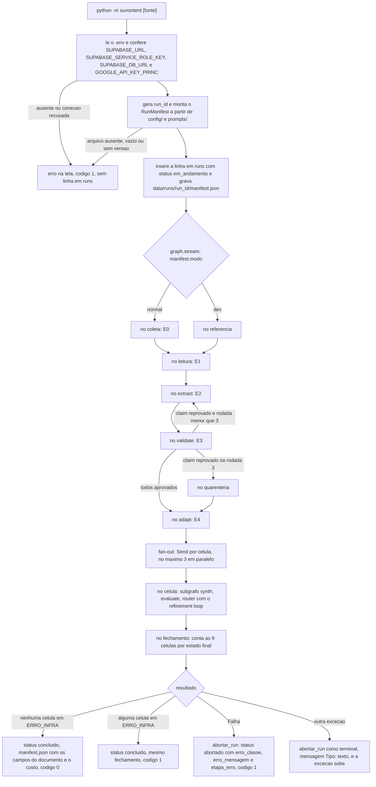

# Fluxo de execução (run)

Este documento descreve como um run começa, como o grafo é montado e executado e como ele termina, concluído ou abortado. A ingestão (E0 e o modo `--dev`) está em `docs/fluxos/ingestao.md`, a leitura (E1) em `docs/fluxos/leitura.md`, a extração e a validação (E2 e E3) em `docs/fluxos/extracao.md`, o plano editorial (E4) em `docs/fluxos/plano-editorial.md`, a síntese (E5) em `docs/fluxos/sintese.md`, a avaliação e o Router (E6 e E7) em `docs/fluxos/avaliacao.md`, o dashboard em `docs/fluxos/dashboard.md`, e o RunManifest e o estado em `docs/arquiteturas.md`.

## Responsabilidades

| Peça | Papel |
| ---- | ----- |
| `sunontent/__main__.py` | Ponto de entrada (`python -m sunontent [fonte] [--dev]`). Lê o `.env`, confere as credenciais do Supabase, do Gemini e do Groq, gera o `run_id`, monta o manifest, registra o run, executa o grafo escrevendo as linhas de etapa no terminal e fecha o run como `concluido` ou `abortado`, com o custo do run. |
| `sunontent/graph.py` | Monta o grafo LangGraph: as duas entradas (E0 ou referência), a E1, a E2, a E3, o loop E2/E3, a quarentena, a E4, o fan-out das 9 células (subgrafo E5, E6 e E7 com o refinement loop) e o fechamento, as constantes `K`, `RODADAS_EXTRACAO`, `RODADAS_PLANO` e `MAX_CONCORRENCIA`, `config_execucao()`, `construir_grafo()` e `construir_grafo_celula()`. A ordem das etapas, o fan-out e o retry ficam só aqui. |
| `sunontent/manifesto.py` | Lê `config/` e `prompts/` e devolve o `RunManifest` sem os campos do documento. |
| `sunontent/schemas.py` | `RunManifest`, `PipelineState`, `CelulaGrafoState` e os tipos `Nivel`, `Fonte` e `Modo`. |
| `sunontent/llm.py` | `conferir_credenciais` (`GOOGLE_API_KEY_PRINC` e `GROQ_API_KEY`) e `criar_cliente`: um `ClienteLLM` por run, com as chaves do Gemini na ordem `GOOGLE_API_KEY_PRINC` e `GOOGLE_API_KEY_SEC` e o juiz no Groq (`GROQ_API_KEY`), que acumula os tokens e o custo do run. As células chamam o cliente em paralelo, e as somas de tokens e de custo passam por uma trava (`threading.Lock`). |
| `sunontent/persistencia.py` | Funções do run: `criar_run`, `concluir_run`, `abortar_run`, `gravar_manifest_local` e `criar_repositorio_supabase`. Única porta de gravação no Supabase e em `data/`. |
| `sunontent/nodes/` | Nós finos: `coleta` e `referencia` (entradas), `leitura` (E1), `extract` (E2), `validate` (E3), `quarentena`, `adapt` (E4), `synth` (E5), `evaluate` (E6), `router` (E7) e `fechamento`. Os nós da E0 à E4 não tratam erro: a `Falha` sobe até o `__main__.py`. Os da E5 à E7 pegam a `Falha` da célula e a gravam como `ERRO_INFRA` (`docs/fluxos/avaliacao.md`). |

## Ciclo de vida do run



1. **Parâmetros.** `fonte` é opcional e vale `copom`, `cvm` ou `b3`; sem ela, as três rodam em sequência, um run por fonte. `--dev` escolhe o documento de referência no lugar do download.
2. **Credenciais.** O `.env` da raiz do repositório é carregado e as variáveis obrigatórias de `.env.example` são conferidas: as três do Supabase, por `persistencia.criar_repositorio_supabase`, e a `GOOGLE_API_KEY_PRINC` e a `GROQ_API_KEY`, por `llm.conferir_credenciais`. A `GOOGLE_API_KEY_SEC` é opcional: sem ela, o run roda só com a principal, sem chave de reserva. O banco recebe um `select 1` sem retentativa. Se algo falhar, a execução para com a mensagem na tela e código de saída 1, **sem criar linha em `runs`** e sem chamar `abortar_run`.
3. **`run_id` e manifest.** O `run_id` tem o formato `<fonte>_<AAAAMMDDTHHMMSSZ>_<6 hex>`, por exemplo `copom_20261006T150000Z_9f2c1a`, e o instante é o mesmo do `timestamp` do manifest. Se a config for inválida, a execução para antes de existir linha em `runs`.
4. **Registro.** `criar_run` insere a linha em `runs` com status `em_andamento` (sem efeito se o `run_id` já existe) e o `manifest.json` local é gravado em seguida.
5. **Execução.** Os recursos vão em `config["configurable"]`: `repositorio`, `raiz` (raiz do repositório, de onde vêm `prompts/` e `config/`), `raiz_dados` (`data/`), `llm` (o `ClienteLLM` do run), `pasta_referencia` (`tests/fixtures/referencia/`) e, nos testes, `cliente_http`. Cada run recebe um `ClienteLLM` novo, para que o custo acumulado seja só daquele run. O `__main__.py` roda o grafo com `stream`. Ele escreve no terminal o início e o fim de cada etapa (ver "Linhas de etapa no terminal") e guarda o nome do último nó iniciado, que é a etapa do erro se o run abortar.
6. **Fim.** Concluído ou abortado, como descrito abaixo.

O código de saída é 0 para run concluído sem célula em `ERRO_INFRA` e 1 para run concluído com alguma célula em `ERRO_INFRA`, para run abortado e para erro antes de existir o run. Célula `REPROVADA` não muda o código: é um resultado da avaliação, não uma falha do run.

## O grafo

```
START -> (modo normal) coleta     -> leitura -> extract -> validate -> adapt -> celula (x9) -> fechamento -> END
      -> (modo dev)    referencia -> leitura -> extract -> validate -> adapt -> celula (x9) -> fechamento -> END
                                                  ^           |
                                                  +-----------+  claim reprovado e rodada < 3
                                                              |
                                                              +--> quarentena -> adapt   claim reprovado e rodada = 3

celula (subgrafo, um por célula):  START -> synth -> evaluate -> router -> END
                                                ^                    |
                                                +--------------------+  reprovada e tentativa < K
                                    synth com falha vai direto ao router
```

- A aresta condicional de `START` lê `state.manifest.modo`: `dev` entra pelo nó `referencia`, e `normal` entra pelo nó `coleta` (E0).
- As duas entradas entregam um `DocumentoFonte` em `documento_fonte` e seguem para o nó `leitura` (E1), que entrega o `DocumentoProcessado` em `documento`.
- O nó `extract` (E2) coloca o FactSheet não assinado no estado, e o nó `validate` (E3) o confere. Sem claim reprovado, o FactSheet é assinado e o grafo segue para o nó `adapt` (E4). Com claim reprovado, `depois_da_validacao` volta ao `extract` enquanto `rodada < RODADAS_EXTRACAO` (3); na terceira rodada, segue para o nó `quarentena`, que grava os reprovados em quarentena e assina o FactSheet com os válidos (sem nenhum válido, levanta `FalhaTerminal`). O loop e a quarentena estão detalhados em `docs/fluxos/extracao.md`.
- O nó `adapt` (E4) recebe o FactSheet assinado, na E3 ou na quarentena, roda o loop do gate dentro dele, até `RODADAS_PLANO` (3), e grava o plano e as 9 células em `PENDENTE`. Depois dele, `disparar_celulas` devolve um `Send` por célula do plano. A E4 está detalhada em `docs/fluxos/plano-editorial.md`.
- O nó `celula` roda o subgrafo de uma célula (`construir_grafo_celula`: `synth` (E5), `evaluate` (E6) e `router` (E7), com o retry voltando ao `synth`) e devolve só a célula final. As 9 células rodam em paralelo, no máximo `MAX_CONCORRENCIA` (3) ao mesmo tempo: o limite vai em `max_concurrency` do config de cada execução (`config_execucao`). Cada célula é isolada: a `Falha` da E5 ou da E6 vira `ERRO_INFRA` daquela célula e as outras seguem. Uma exceção que não é `Falha` (bug) aborta o run, com o nó do subgrafo em `etapa_erro`. `PipelineState.celulas` junta as 9 entradas por um reducer (`juntar_celulas`).
- O nó `fechamento` espera as 9 células, confere que todas têm estado final e guarda em `contagem_celulas` quantas terminaram em cada um (`APROVADA`, `REPROVADA`, `ERRO_INFRA`). Não grava nada: o estado final de cada célula já foi gravado pela E7. Célula sem estado final é bug e levanta `ValueError`.
- `K = 2` e `MAX_CONCORRENCIA = 3` são constantes de `graph.py`. Os valores lidos no início do run entram no manifest.
- `PipelineState` tem `run_id`, `manifest`, `documento_fonte` (entradas), `documento` (E1), `factsheet` (não assinado na E2, assinado na E3) os campos do loop E2/E3 (`rodada`, `propostas`, `pendencias` e `correcoes`) os da E4: `rodada_plano`, `plano` e `celulas` (9 entradas) e o do fechamento: `contagem_celulas`. A E4 cria as 9 células em `PENDENTE` e a E7 grava o estado final de cada uma.

## Linhas de etapa no terminal

`_rodar_grafo` roda o grafo com `stream_mode=["tasks", "values"]` e `subgraphs=True`: cada evento de tarefa vira uma linha e o último `values` do grafo principal é o estado final, o mesmo que o `invoke` devolveria.

```
run cvm_20261013T152557Z_c95dc4 (normal)
etapa coleta: iniciada
etapa coleta: concluída
etapa leitura: iniciada
...
etapa adapt: concluída
celula iniciante__artigo synth 1: iniciada
celula iniciante__carrossel synth 1: iniciada
celula iniciante__roteiro synth 1: iniciada
celula iniciante__artigo synth 1: concluída
celula iniciante__artigo evaluate 1: iniciada
...
celula iniciante__artigo router 2: concluída
celula iniciante__artigo: APROVADA
...
etapa fechamento: concluída
concluído: cvm_fato_relevante_16993_1575717 (215aa96736b4), 9 claims, plano em 1 rodada, 9 células (7 APROVADA, 2 REPROVADA), 10836 tokens, R$ 0.1516
```

- O nome é o do nó em `graph.py` (`coleta`, `referencia`, `leitura`, `extract`, `validate`, `quarentena`, `adapt`, `fechamento`). No loop E2/E3, `extract` e `validate` aparecem uma vez por rodada.
- Os nós do subgrafo da célula (`synth`, `evaluate`, `router`) não têm linha `etapa`. Cada um escreve `celula <celula_id> <no> <tentativa>: iniciada` e `celula <celula_id> <no> <tentativa>: concluída`, e a célula, ao terminar, `celula <celula_id>: <ESTADO>` (`APROVADA`, `REPROVADA` ou `ERRO_INFRA`). A tentativa é a da peça que o nó trata: no `synth`, a que está sendo gerada; no `evaluate` e no `router`, a que está sendo avaliada. Com até 3 células em paralelo, as linhas de células diferentes se intercalam; as de uma célula seguem a ordem do subgrafo.
- Com claims em quarentena, a linha final diz quantos: `..., 22 claims, 1 em quarentena, ...`.
- A linha final diz em quantas rodadas o plano da E4 ficou pronto e, com `aviso`, que o plano tem aviso: `plano em 3 rodadas (com aviso)`. Depois dela vem a contagem das células por estado final, só com os estados que existem: `9 células (7 APROVADA, 2 REPROVADA)`.
- A etapa que falha não tem a linha `concluída`: a exceção sobe e a linha seguinte é `abortado (<classe>): <mensagem>`.
- O dashboard (`docs/fluxos/dashboard.md`) lê essas linhas para mostrar em que etapa o run está.

## Manifest

`manifesto.montar(raiz, run_id, timestamp, modo, fonte, k, max_concorrencia)` lê estes arquivos da raiz do repositório:

| Campo do manifest | Origem |
| ----------------- | ------ |
| `level_specs` | chave `versao` de `config/levels/<nivel>.yaml`. Se o arquivo traz `nivel`, ele precisa ser igual ao nome do arquivo. |
| `glossario_versao` | chave `versao` de `config/glossario.yaml`. |
| `modelos` | mapa `modelos` de `config/models.yaml` (nó para snapshot). Sem a chave, fica vazio. A chave `versao` é obrigatória. |
| `prompts` | linha `{# versao: N #}` no início de cada `prompts/*.j2`. Template vazio é ignorado e não entra em `prompts` nem em `arquivos_sha256`. Template com conteúdo e sem a linha de versão para o run. |
| `arquivos_sha256` | SHA-256 de cada arquivo lido, com `\r\n` normalizado para `\n`, chaveado pelo caminho relativo com `/`. |
| `K` | constante de `graph.py`. |
| `max_concorrencia` | constante `MAX_CONCORRENCIA` de `graph.py`: quantas células rodam ao mesmo tempo. |

`versao` precisa ser um inteiro maior ou igual a 1. Arquivo ausente, YAML inválido, arquivo vazio ou `versao` inválida levantam `FalhaTerminal` com o caminho do arquivo, antes de existir linha em `runs`.

Os campos do documento (`doc_id`, `doc_sha256`, `url_origem`, `coletado_em`, `coleta_id`) começam vazios e são preenchidos quando o `DocumentoFonte` é entregue: em `runs`, pela E0 ou pelo `ingestao/referencia.py`, e no `manifest.json`, no fechamento do run concluído.

## Run concluído

`concluir_run` atualiza `runs` para `status = 'concluido'` com `where run_id = ... and status = 'em_andamento'` e, só depois, regrava o `manifest.json` com os campos do documento e o custo do run (`custo_total_tokens` e `custo_total_brl`, acumulados pelo `ClienteLLM`). Se o update não alterar exatamente uma linha, a função levanta `FalhaTerminal`.

No terminal, a última linha do run traz o documento, os claims do FactSheet, as rodadas do plano, as células por estado final e o custo:

```
concluído: cvm_fato_relevante_16993_1575717 (215aa96736b4), 9 claims, plano em 1 rodada, 9 células (9 APROVADA), 10836 tokens, R$ 0.1516
```

O run fecha como `concluido` mesmo com célula em `ERRO_INFRA`: o estado de cada célula está em `celulas`, e o código de saída 1 avisa que alguma ficou sem avaliação por falha de infraestrutura.

Em `runs`, o custo é somado na mesma instrução que grava cada span (`docs/fluxos/extracao.md`, Custo).

## Run abortado

Toda `Falha` que sobe do grafo (E0, referência do `--dev`, E1, E2, E3, E4) é registrada por `persistencia.abortar_run(repositorio, raiz_dados, manifest, classe, mensagem, etapa)`:

1. A mensagem aparece na tela (stderr) antes de qualquer gravação.
2. Com `com_retentativa`, o `abortar_run` faz o update em `runs`: `status = 'abortado'`, `erro_classe`, `erro_mensagem` e `etapa_erro`, `where run_id = ... and status = 'em_andamento'`. A `etapa_erro` é o nome do nó em que o run abortou: o que estava em execução. É nula quando a falha veio antes do primeiro nó. Os campos de documento não são tocados: podem estar vazios se o run abortou antes de a E0 entregar o documento.
3. O mesmo erro é gravado em `data/runs/<run_id>/manifest.json`, com o custo acumulado até o aborto.
4. O código de saída é 1.

As constraints de `runs` são respeitadas: `status = 'abortado'` se, e somente se, `erro_classe` não é nulo, `erro_classe` e `erro_mensagem` são nulos juntos, e `etapa_erro` só é preenchida em run abortado. Mensagem vazia vira `sem mensagem`.

| Situação | Resultado |
| -------- | --------- |
| `Falha` (retriável esgotada ou terminal) no grafo | Run `abortado` com `falha.classe`, `falha.mensagem` e a etapa do erro. |
| Exceção que não é `Falha` (bug) | Run `abortado` como `terminal`, mensagem `NomeDoTipo: texto`, com a etapa do erro, e a exceção sobe com o traceback. |
| Run já `concluido` ou `abortado` | O update não altera nada: o primeiro estado final é mantido. |
| Supabase inacessível no update (retentativas esgotadas) | O erro fica só no `manifest.json`, com `status` `em_andamento`, `erro_classe`, `erro_mensagem` (a mensagem original mais a nota `status não gravado no Supabase`) e `etapa_erro`. A linha de `runs` segue `em_andamento`. A falha de gravação não é levantada e não esconde o erro original. |
| Falha antes de existir o run (credencial, conexão ou config) | Mensagem na tela e código 1. Nenhuma linha em `runs` e nenhuma chamada a `abortar_run`. |
| Falha ao gravar o fechamento de um run concluído | Mensagem na tela e código 1. A linha segue `em_andamento` e o `manifest.json` mantém o status gravado no início. |

A classificação dos erros da E0 e do `--dev` está em `docs/fluxos/ingestao.md`, seção "Classificação de erros".

## Arquivos gravados por um run

```
data/runs/<run_id>/
├── manifest.json            # RunManifest, status, erro e custo do run
├── documento.json           # E1: DocumentoProcessado
├── spans/<span_id>.json     # E2: uma chamada de LLM por arquivo
├── validacoes/<rodada>.json # E3: resultado de cada rodada
├── factsheet.json           # E3: FactSheet assinado, sem a tabela_numeros
├── quarentena.json          # claims em quarentena, quando há
├── validacoes_plano/<rodada>.json  # E4: problemas do gate e saída do planejador em cada rodada
├── plano.json               # E4: núcleo, aviso e os 3 planos de nível
└── celulas/<celula_id>/     # estado.json (a E4 cria em PENDENTE e a E7 grava o estado final), peca_<t>.json e scorecard_<t>.json por tentativa
```

O `manifest.json` contém os campos do `RunManifest` (em JSON) e, ao lado deles, `status`, `erro_classe`, `erro_mensagem` e `etapa_erro`. Só o processo principal grava esse arquivo. Todos os arquivos são gravados num arquivo temporário renomeado no fim, e sempre depois de gravar no Supabase. Um run abortado tem só os arquivos das etapas que chegaram a gravar.

## Como rodar

```
pip install -r requirements.txt
cp .env.example .env        # preencher as quatro variáveis
python -m sunontent                  # modo normal: copom, cvm e b3 em sequência, um run por fonte
python -m sunontent --dev            # as três fontes com o documento de referência, sem download
python -m sunontent copom [--dev]    # só uma fonte
```

Sem a fonte, as três rodam em sequência, cada uma com o seu `run_id`. Se um run abortar, os seguintes continuam e o código de saída é 1. Rode a partir da raiz do repositório. O modo `--dev` precisa de `tests/fixtures/referencia/<fonte>.pdf` e `<fonte>.json`; sem eles, o run é abortado com a mensagem do arquivo ausente.

## Testes

```
python -m pytest
```

`tests/test_main_graph.py` cobre o manifest, a escolha da entrada do grafo, os dois modos, o loop E2/E3, a E4 no grafo, as linhas de etapa no terminal e os caminhos de erro: falha da E0, bug, referência ausente, hash divergente, config inválida, Supabase fora no aborto, run concluído não sobrescrito, credenciais ausentes, claim que não converge e extractor sem claims. `tests/test_fanout.py` cobre o `Send` com `max_concurrency`, o isolamento de falhas, o fechamento, as linhas de célula no terminal e a trava do custo. Os testes usam o repositório em memória e o LLM simulado (`tests/conftest.py`) e `tmp_path`; não acessam internet, o Gemini nem o Supabase do site.
